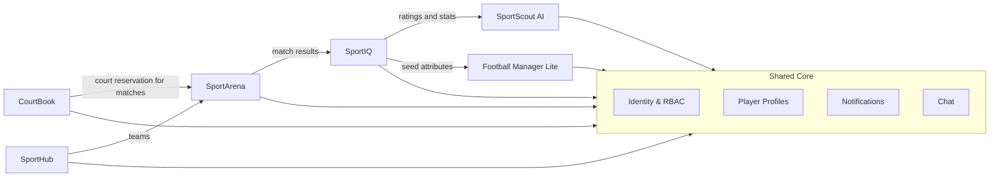
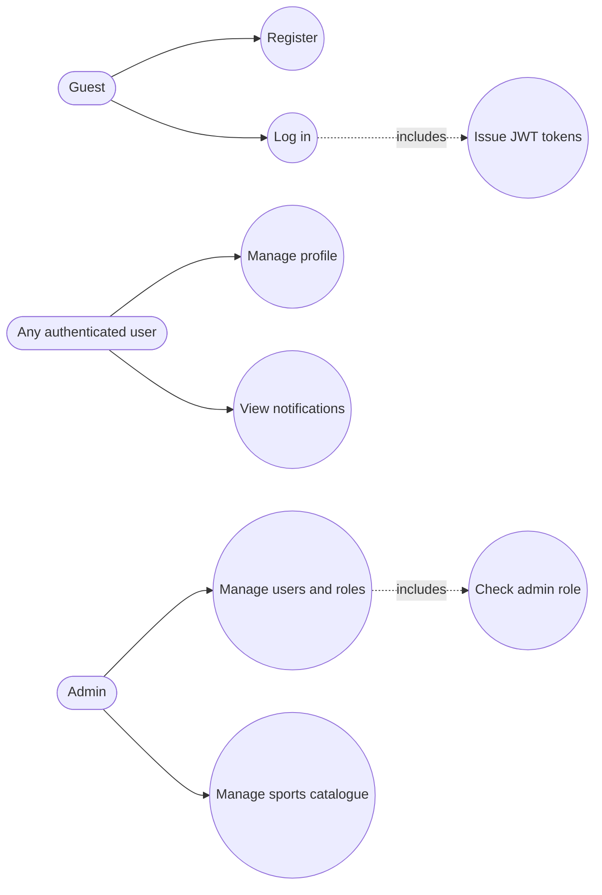
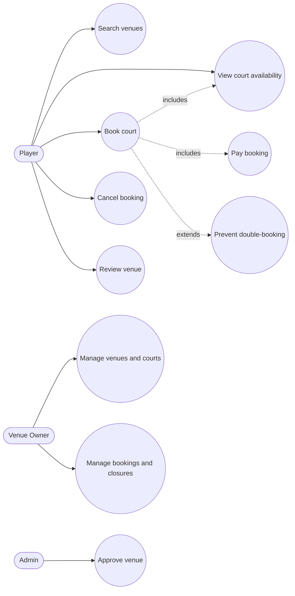
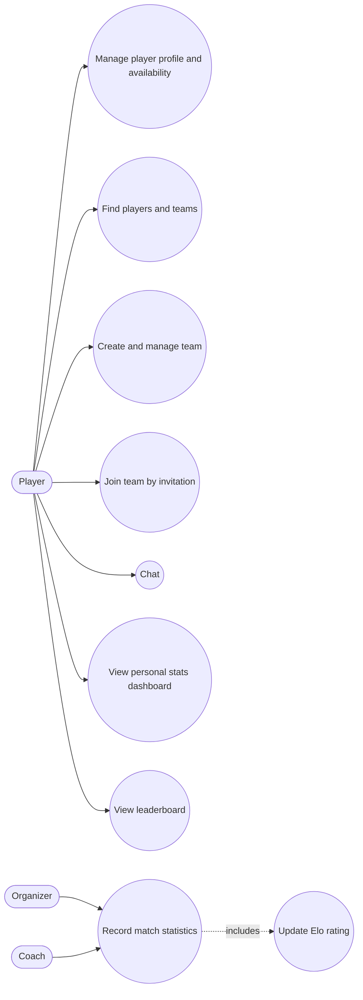
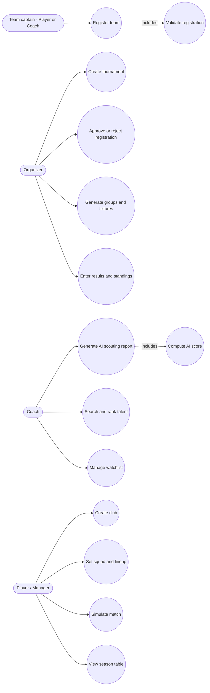

# Software Requirements Specification (SRS)

**Project:** Sports Ecosystem & AI Platform
**Course:** Đồ án Cơ sở 2 — Faculty of Computer Science
**Document ID:** `01-SRS` | **Version:** 1.0 | **Status:** Draft for review
**Standard followed:** structure adapted from IEEE Std 830-1998 / ISO/IEC/IEEE 29148

---

## Table of Contents

1. [Introduction](#1-introduction)
2. [Overall Description](#2-overall-description)
3. [User Roles and Permissions](#3-user-roles-and-permissions)
4. [Functional Requirements](#4-functional-requirements)
5. [Non-Functional Requirements](#5-non-functional-requirements)
6. [Use-Case Model](#6-use-case-model)
7. [Detailed Use-Case Specifications](#7-detailed-use-case-specifications)
8. [Requirements Traceability Matrix](#8-requirements-traceability-matrix)
9. [Appendix: Assumptions and Open Issues](#9-appendix-assumptions-and-open-issues)

---

## 1. Introduction

### 1.1 Purpose

This document specifies the functional and non-functional requirements of the
**Sports Ecosystem & AI Platform**. It is the contractual baseline between the
project team, the supervising lecturers and the future users, and the input for
the data model (`02-ERD.md`) and architecture (`03-ARCHITECTURE-AND-FLOWS.md`).

### 1.2 Scope

The platform is a web-based system that unifies the amateur-sports workflow in
one place — from finding a court, to forming a team, entering a tournament,
tracking performance, and being discovered by coaches. It consists of **six
modules** over a **shared core** (identity, roles, sports catalogue, player
profiles, notifications, chat):

| Module | Scope summary |
|--------|---------------|
| **CourtBook** | Venues and courts are published by owners; players search availability and book time slots online with guaranteed no double-booking. |
| **SportHub** | Player profiles per sport, weekly availability, team creation and membership, player search / matchmaking, real-time chat. |
| **SportIQ** | Captures per-match player statistics, computes an Elo-style skill rating per sport, and presents dashboards and leaderboards. |
| **SportArena** | Organizers create tournaments; teams register; organizers approve; groups and fixtures are generated; results update standings. |
| **SportScout AI** | Machine-learning assistant that scores players from SportIQ data and recommends talent to coaches; coaches keep watchlists and reports. |
| **Football Manager Lite** | Light management game: users run a virtual football club, set lineups and simulate fixtures; virtual players can be seeded from real SportIQ data. |

**Out of scope (version 1.0):** native mobile apps; video streaming or
analysis; real payment-gateway settlement (a mock/sandbox provider is used);
multi-language content beyond Vietnamese and English; league licensing or
betting features.

### 1.3 Definitions, Acronyms and Abbreviations

| Term | Definition |
|------|------------|
| **SRS** | Software Requirements Specification |
| **RBAC** | Role-Based Access Control |
| **JWT** | JSON Web Token (RFC 7519) used for stateless authentication |
| **Court** | A single bookable playing area (pitch, badminton court, etc.) inside a venue |
| **Venue** | A facility owned by a `venue_owner` that contains one or more courts |
| **Slot** | A contiguous time interval `[start_time, end_time)` on a court |
| **Booking** | A reservation of a slot on a court by a user |
| **Double-booking** | Two active bookings that overlap in time on the same court |
| **Team** | A named group of players for a given sport |
| **Registration** | A team's application to join a tournament |
| **Elo rating** | Numeric skill indicator updated after every rated match |
| **FR / NFR / UC** | Functional Requirement / Non-Functional Requirement / Use Case |
| **MoSCoW** | Priority scheme: **M**ust, **S**hould, **C**ould, **W**on't (this release) |

### 1.4 References

1. IEEE Std 830-1998 — Recommended Practice for Software Requirements Specifications.
2. ISO/IEC/IEEE 29148:2018 — Requirements engineering.
3. RFC 7519 — JSON Web Token (JWT); OWASP ASVS 4.0 and OWASP Top 10 (2021).
4. PostgreSQL 16 documentation — *Exclusion constraints* and *Range types*.
5. Project conventions — repository `README.md`.

### 1.5 Document Overview

Section 2 gives context; Section 3 defines actors; Sections 4–5 list
requirements with unique IDs; Sections 6–7 model behaviour with use cases;
Section 8 links requirements to use cases.

---

## 2. Overall Description

### 2.1 Product Perspective

The product is a new, self-contained web application: a browser-based
single-page client communicating with a REST backend under the prefix
`/api/v1`, persisting data in PostgreSQL. Modules are developed as separate
packages of one **modular monolith** and share the core identity and data
layer, so that, for example, a *player rating* (SportIQ) can feed a *scouting
report* (SportScout AI) and a *virtual player* (Football Manager Lite).

### 2.2 Product Functions (high level)

- Account management, authentication and role-based authorization.
- Venue/court publishing, availability search, booking and cancellation.
- Player profiles, availability calendar, teams, matchmaking and chat.
- Tournament lifecycle management with registration approval workflow.
- Statistics capture, rating computation, leaderboards.
- AI talent scoring and recommendation.
- Football-management simulation.
- In-app notifications for every significant event.

### 2.3 User Characteristics

| User class | Technical skill | Frequency | Notes |
|------------|-----------------|-----------|-------|
| Player | Low–medium | Several times per week | Mobile browser is the primary device |
| Venue owner | Low | Daily | Needs a simple calendar-style management view |
| Organizer | Medium | Per tournament | Handles many registrations and fixtures |
| Coach | Medium | Weekly | Interprets statistics and AI output |
| Admin | High | Daily | Moderation and platform configuration |

### 2.4 Operating Environment

- Client: current versions of Chrome, Edge, Firefox, Safari; responsive from 360 px width.
- Server: Linux container; PostgreSQL 16; time stored in UTC.
- Deployment via Docker Compose (development) and a single VM or PaaS (demo).

### 2.5 Design and Implementation Constraints

| ID | Constraint |
|----|-----------|
| CON-01 | All endpoints are under the base prefix `/api/v1`. |
| CON-02 | All errors use the envelope `{ "detail": "..." }`. |
| CON-03 | Database tables are plural `snake_case`; PostgreSQL is the only primary datastore. |
| CON-04 | Documentation (SRS, ERD, architecture) must be approved before coding starts (faculty rule). |
| CON-05 | The project must be deliverable within one academic semester by the student team. |
| CON-06 | Only open-source or free-tier tools and libraries may be used. |

### 2.6 Assumptions and Dependencies

| ID | Assumption / dependency |
|----|--------------------------|
| ASM-01 | Users have a modern browser and internet access. |
| ASM-02 | Email delivery (verification, reset) is provided by an SMTP service; for the demo a console/mock mailer is acceptable. |
| ASM-03 | Payments are simulated by a sandbox provider returning success/failure callbacks. |
| ASM-04 | Maps and geolocation use free map tiles; coordinates are entered by the venue owner. |
| ASM-05 | The AI model is trained on sample/synthetic and collected platform data; its output is *advisory only*. |

---

## 3. User Roles and Permissions

### 3.1 Actors

| Actor | Code | Description |
|-------|------|-------------|
| Guest | *(none)* | Unauthenticated visitor; can browse public venues, tournaments and leaderboards. |
| Administrator | `admin` | Operates the platform: manages users and roles, approves venues, moderates content, manages the sports catalogue. |
| Player | `player` | Default role. Books courts, maintains a profile and availability, joins teams, plays matches, uses chat and Football Manager Lite. |
| Venue Owner | `venue_owner` | Owns venues and courts; sets prices and opening hours; manages incoming bookings and closures. |
| Organizer | `organizer` | Creates and runs tournaments; approves or rejects team registrations; records results. |
| Coach | `coach` | Analyses player data, uses SportScout AI, keeps watchlists and reports, may coach a team. |
| System / Scheduler | — | Background jobs (booking expiry, reminders, rating recalculation). |
| AI Engine | — | Internal component producing player scores and recommendations. |

A user may hold **several roles** simultaneously (e.g. `player` + `coach`); the
`admin` role is assigned only by another administrator.

### 3.2 Permission Matrix (summary)

Legend: ● full · ◐ own resources only · ○ read-only · — no access

| Capability | Guest | player | venue_owner | organizer | coach | admin |
|------------|:----:|:------:|:-----------:|:---------:|:-----:|:-----:|
| Browse venues / tournaments / leaderboards | ○ | ○ | ○ | ○ | ○ | ● |
| Register / log in | ● | — | — | — | — | — |
| Manage own account & profile | — | ◐ | ◐ | ◐ | ◐ | ● |
| Book / cancel courts | — | ◐ | ◐ | ◐ | ◐ | ● |
| Manage venues & courts | — | — | ◐ | — | — | ● |
| Approve venue listings | — | — | — | — | — | ● |
| Create / manage teams | — | ◐ | — | — | ◐ | ● |
| Register team to tournament | — | ◐ (captain) | — | — | ◐ (captain) | ● |
| Create tournaments, approve registrations | — | — | — | ◐ | — | ● |
| Record match results & stats | — | — | — | ◐ | ◐ (own team) | ● |
| View AI scouting & manage watchlist | — | — | — | — | ◐ | ● |
| Football Manager Lite | — | ◐ | ◐ | ◐ | ◐ | ● |
| Manage users, roles, sports catalogue | — | — | — | — | — | ● |

The authoritative endpoint-level matrix is in `03-ARCHITECTURE-AND-FLOWS.md`.

---

## 4. Functional Requirements

Priority uses MoSCoW. IDs are stable and referenced by use cases and tests.

### 4.1 Core Platform (CORE)

| ID | Requirement | Priority |
|----|-------------|:--------:|
| FR-CORE-01 | The system shall allow a guest to register with email, username, password and full name, selecting an initial role among `player`, `venue_owner`, `organizer`, `coach`. | M |
| FR-CORE-02 | The system shall reject registration when the email or username already exists (HTTP 409). | M |
| FR-CORE-03 | The system shall store passwords only as salted, adaptive hashes (bcrypt/Argon2). | M |
| FR-CORE-04 | The system shall authenticate users by email and password and issue a short-lived JWT access token and a rotating refresh token. | M |
| FR-CORE-05 | The system shall enforce RBAC on every protected endpoint and return 401 for unauthenticated and 403 for unauthorized requests. | M |
| FR-CORE-06 | The system shall allow users to view and edit their account data and change their password. | M |
| FR-CORE-07 | The system shall allow an admin to list, search, activate/deactivate users and grant/revoke roles. | M |
| FR-CORE-08 | The system shall allow an admin to manage the `sports` catalogue (e.g. football, badminton, tennis). | M |
| FR-CORE-09 | The system shall create in-app notifications for significant events and let users list and mark them as read. | M |
| FR-CORE-10 | The system shall support password reset via a time-limited emailed link. | S |
| FR-CORE-11 | The system shall support email verification after registration. | C |
| FR-CORE-12 | The system shall deliver notifications in near real time (WebSocket/SSE) in addition to polling. | S |

### 4.2 CourtBook (CB)

| ID | Requirement | Priority |
|----|-------------|:--------:|
| FR-CB-01 | A venue owner shall create, edit and deactivate venues (name, address, city, coordinates, opening hours, contact). | M |
| FR-CB-02 | A venue owner shall create, edit and deactivate courts of a venue, each tied to a sport, with surface type and hourly price. | M |
| FR-CB-03 | Newly created venues shall be in status `pending` and become publicly visible only after admin approval. | M |
| FR-CB-04 | Users shall search venues by city/district, sport, price range, rating and distance. | M |
| FR-CB-05 | Users shall view a court's availability for a selected date as a timeline of free/busy slots. | M |
| FR-CB-06 | A player shall create a booking for a court by choosing start and end time (multiples of 30 minutes, within opening hours, in the future). | M |
| FR-CB-07 | **The system shall guarantee that two active bookings never overlap on the same court**, including under concurrent requests (enforced in the database). | M |
| FR-CB-08 | The system shall compute the total price from the hourly price and duration and show it before confirmation. | M |
| FR-CB-09 | A booking shall start as `pending` with a payment-hold expiry (default 10 minutes) and become `confirmed` after successful payment, or `expired` if unpaid. | M |
| FR-CB-10 | A user shall cancel own booking before a configurable cutoff (default 4 hours before start); the court slot is then released. | M |
| FR-CB-11 | A venue owner shall view the booking calendar of own courts and block time ranges (maintenance, private events). | M |
| FR-CB-12 | The system shall notify the venue owner and the player on booking confirmation, cancellation and expiry. | M |
| FR-CB-13 | A player shall rate and review a venue after a completed booking (one review per booking). | S |
| FR-CB-14 | The system shall record payments (amount, method, status, reference) for each booking. | S |
| FR-CB-15 | The system shall send a reminder notification 2 hours before a confirmed booking. | C |

### 4.3 SportHub (SH)

| ID | Requirement | Priority |
|----|-------------|:--------:|
| FR-SH-01 | A player shall create one profile per sport (position, skill level, preferred foot/hand, height, weight, bio, city). | M |
| FR-SH-02 | A player shall declare recurring weekly availability windows per profile. | M |
| FR-SH-03 | Users shall search players by sport, city, position, skill level and availability overlap. | M |
| FR-SH-04 | A player or coach shall create a team for a sport and becomes its captain / coach. | M |
| FR-SH-05 | A team captain shall invite players; invited players shall accept or decline; members may leave. | M |
| FR-SH-06 | A team captain shall remove members, assign jersey numbers/positions and transfer captaincy. | S |
| FR-SH-07 | The system shall provide chat rooms of type `direct`, `team` and `tournament`; team and tournament rooms are created automatically. | M |
| FR-SH-08 | Chat participants shall send and receive text messages in real time and retrieve paginated history. | M |
| FR-SH-09 | The system shall suggest teams or players that match a player's sport, city, level and availability (matchmaking). | S |
| FR-SH-10 | Users shall report abusive chat messages; admins shall review reports. | C |

### 4.4 SportIQ (SIQ)

| ID | Requirement | Priority |
|----|-------------|:--------:|
| FR-SIQ-01 | The system shall store per-player statistics for each finished match (minutes, points/goals, assists, cards, performance score, sport-specific JSON). | M |
| FR-SIQ-02 | Authorized users (organizer, admin, team coach/captain) shall enter or correct match statistics; corrections shall be auditable. | M |
| FR-SIQ-03 | The system shall maintain an Elo-style rating per player per sport and update it after each rated match. | M |
| FR-SIQ-04 | The system shall keep a rating history (old, new, delta, match) for every update. | M |
| FR-SIQ-05 | A player shall view a personal dashboard: totals, averages, form (last N matches) and rating trend. | M |
| FR-SIQ-06 | Users shall view public leaderboards by sport, city and period. | S |
| FR-SIQ-07 | Users shall compare two players on selected metrics. | C |
| FR-SIQ-08 | Statistics shall be exportable as CSV by the owning player. | C |

### 4.5 SportArena (SA)

| ID | Requirement | Priority |
|----|-------------|:--------:|
| FR-SA-01 | An organizer shall create a tournament (sport, format, dates, registration window, max teams, minimum roster size, fee). | M |
| FR-SA-02 | Supported formats shall include `round_robin`, `knockout` and `group_knockout`. | M |
| FR-SA-03 | A tournament shall follow the lifecycle `draft → open → closed → ongoing → completed` (or `cancelled`). | M |
| FR-SA-04 | A team captain shall register a team to an `open` tournament within the registration window; the registration starts as `pending`. | M |
| FR-SA-05 | The system shall validate registration: sport matches, captain identity, minimum roster, no duplicate, capacity not exceeded. | M |
| FR-SA-06 | The organizer shall approve or reject each registration (rejection requires a reason); the captain is notified. | M |
| FR-SA-07 | The number of `approved` registrations shall never exceed `max_teams`, even under concurrent approvals. | M |
| FR-SA-08 | A captain shall withdraw a pending or approved registration before the tournament starts. | S |
| FR-SA-09 | The organizer shall create groups and assign (manually or by seeded draw) approved teams to groups. | M |
| FR-SA-10 | The system shall generate fixtures for the chosen format and allow schedule edits; a fixture may reference a booked court (CourtBook). | M |
| FR-SA-11 | The organizer shall enter match scores; the system shall update group standings (played, W/D/L, GF/GA, points). | M |
| FR-SA-12 | The system shall publish public tournament pages: teams, groups, fixtures, results and standings. | S |
| FR-SA-13 | Finishing a rated match shall trigger SportIQ rating updates. | S |

### 4.6 SportScout AI (SC)

| ID | Requirement | Priority |
|----|-------------|:--------:|
| FR-SC-01 | The system shall compute an **AI score** (0–100) and an attribute breakdown for a player from SportIQ statistics and profile data. | M |
| FR-SC-02 | A coach shall generate a scouting report for a player; the report stores score, attributes, textual summary and model version. | M |
| FR-SC-03 | A coach shall search/filter talent (sport, position, age range, city, minimum score) and receive a ranked list. | M |
| FR-SC-04 | A coach shall maintain a private watchlist with notes. | M |
| FR-SC-05 | The system shall recommend similar players to a given player/position (nearest-neighbour similarity). | S |
| FR-SC-06 | The system shall explain a score by listing the top contributing factors. | S |
| FR-SC-07 | Reports shall be marked as AI-generated and advisory; players may opt out of being scouted in their profile settings. | S |
| FR-SC-08 | The model shall be retrainable by an admin from stored data, with the version recorded in each report. | C |

### 4.7 Football Manager Lite (FM)

| ID | Requirement | Priority |
|----|-------------|:--------:|
| FR-FM-01 | A user shall create one virtual club with name and starting budget. | M |
| FR-FM-02 | A club shall have a squad of virtual players with position and attributes (pace, shooting, passing, defending, stamina) and overall rating. | M |
| FR-FM-03 | Virtual players may be seeded from real SportIQ data (`source_user_id`) where the real player consents. | S |
| FR-FM-04 | The manager shall choose a formation and starting lineup (11 starters, bench) per fixture. | M |
| FR-FM-05 | The system shall simulate a fixture from lineups and attributes, producing a score and key events, deterministically for a given random seed. | M |
| FR-FM-06 | The system shall organize clubs into seasons with generated fixtures and a league table. | M |
| FR-FM-07 | Users shall view the league table, fixtures, results and match report. | M |
| FR-FM-08 | Players shall improve or decline between seasons based on age and performance. | C |
| FR-FM-09 | A basic transfer market allowing clubs to buy/sell players within budget. | C |

---

## 5. Non-Functional Requirements

### 5.1 Performance

| ID | Requirement | Measure |
|----|-------------|---------|
| NFR-PERF-01 | Read endpoints (search, availability) shall respond within **500 ms** at the 95th percentile with 100 concurrent users on the reference environment. | Load test |
| NFR-PERF-02 | Booking creation shall complete within **1 s** at the 95th percentile. | Load test |
| NFR-PERF-03 | Chat messages shall be delivered to online recipients within **2 s**. | Manual/automated |
| NFR-PERF-04 | An AI score for one player shall be produced within **3 s**. | Benchmark |
| NFR-PERF-05 | Lists shall be paginated (default 20, max 100) to bound payload size. | Code review |

### 5.2 Security

| ID | Requirement |
|----|-------------|
| NFR-SEC-01 | All traffic shall use HTTPS in non-local environments. |
| NFR-SEC-02 | Passwords: minimum 8 characters with letters and digits; stored with bcrypt/Argon2; never logged. |
| NFR-SEC-03 | Access tokens expire within 15 minutes; refresh tokens within 7 days, are stored hashed, rotated on use and revocable. |
| NFR-SEC-04 | Authorization shall be enforced server-side on every request (object-level checks included, e.g. only the venue's owner edits it). |
| NFR-SEC-05 | All SQL access shall use parameterized queries / ORM to prevent injection; all input validated by schema. |
| NFR-SEC-06 | CORS shall allow only configured origins; login and registration endpoints shall be rate limited. |
| NFR-SEC-07 | Error responses shall not leak stack traces or internal identifiers (`{ "detail": "..." }` only). |
| NFR-SEC-08 | Personal data (email, phone) shall be visible only to its owner and admins; scouting requires player opt-in. |
| NFR-SEC-09 | Security-relevant events (login failure, role change) shall be logged with timestamp and actor. |

### 5.3 Reliability and Data Integrity

| ID | Requirement |
|----|-------------|
| NFR-REL-01 | Target availability of **99 %** during the demonstration period. |
| NFR-REL-02 | Booking integrity (no overlap) shall be enforced by a **database constraint**, not application code alone. |
| NFR-REL-03 | Multi-step operations (booking + payment record, approval + notification) shall run in transactions. |
| NFR-REL-04 | Database shall be backed up daily; PostgreSQL data lives on a persistent volume. |
| NFR-REL-05 | Expired `pending` bookings shall be released automatically within 1 minute of expiry. |

### 5.4 Usability and Accessibility

| ID | Requirement |
|----|-------------|
| NFR-USA-01 | The UI shall be responsive (≥ 360 px) and usable on mobile browsers. |
| NFR-USA-02 | A new player shall complete a first booking in ≤ 5 steps / ≤ 3 minutes without training. |
| NFR-USA-03 | The UI shall support Vietnamese and English text; dates/currency in local format (VND). |
| NFR-USA-04 | Forms shall show inline, field-level validation messages mapped from API errors. |
| NFR-USA-05 | Target WCAG 2.1 level AA for colour contrast and keyboard navigation on core flows. |

### 5.5 Maintainability, Portability and Quality

| ID | Requirement |
|----|-------------|
| NFR-MNT-01 | Code is organised per module with clear layers (router → service → repository); modules communicate only through service interfaces. |
| NFR-MNT-02 | Schema changes are made exclusively through versioned migrations. |
| NFR-MNT-03 | Automated tests: ≥ 70 % line coverage on service layer; critical flows (auth, booking, registration) covered by integration tests. |
| NFR-MNT-04 | Conventions in `README.md` (API prefix, error format, naming) are verified in code review/CI. |
| NFR-POR-01 | The whole stack starts with `docker compose up`; no machine-specific configuration. |
| NFR-POR-02 | Configuration only via environment variables; no secrets in the repository. |
| NFR-DOC-01 | The OpenAPI document is generated automatically and kept in sync with the code. |

### 5.6 Scalability and Compliance

| ID | Requirement |
|----|-------------|
| NFR-SCA-01 | The design shall allow horizontal scaling of stateless API instances (JWT, no server sessions). |
| NFR-SCA-02 | Frequently filtered columns shall be indexed (see ERD); search queries shall avoid full table scans. |
| NFR-CMP-01 | Users can request deletion of their account; personal data is anonymised while preserving aggregate statistics. |

---

## 6. Use-Case Model

Mermaid has no native UML use-case notation; actors and use cases are drawn
with `flowchart`. Actors are rounded nodes, use cases are ellipses.

### 6.1 Core / Identity

### 6.2 CourtBook

### 6.3 SportHub and SportIQ

### 6.4 SportArena, SportScout AI and Football Manager Lite

---

## 7. Detailed Use-Case Specifications

**Template.** Every specification states: *ID, Name, Actors, Priority,
Related FRs, Preconditions, Trigger, Main flow, Alternative / exception flows,
Postconditions, Business rules.* Step numbers in alternative flows reference
the main flow.

### 7.1 Core Platform

#### UC-AUTH-01 — Register Account

| Field | Description |
|-------|-------------|
| **Actors** | Guest |
| **Priority / FRs** | Must · FR-CORE-01, 02, 03 |
| **Preconditions** | The guest is not logged in. |
| **Trigger** | The guest opens the registration form. |
| **Main flow** | 1. Guest enters email, username, full name, password and chooses a role (`player` default). 2. System validates field formats and password strength. 3. System verifies that email and username are unused. 4. System hashes the password and creates the `users` record and the matching `user_roles` entry. 5. System returns `201 Created` with the user summary. 6. System creates a welcome notification. |
| **Alternative flows** | **2a.** Validation fails → `422` with field messages; return to step 1. **3a.** Email or username exists → `409` `{ "detail": "Email already registered" }`. **1a.** Guest requests role `admin` → `403` (role not self-assignable). |
| **Postconditions** | A new active account with exactly the chosen role exists. |
| **Business rules** | Email is case-insensitive unique; `admin` is never self-assignable. |

#### UC-AUTH-02 — Log In

| Field | Description |
|-------|-------------|
| **Actors** | Guest |
| **Priority / FRs** | Must · FR-CORE-04, 05 |
| **Preconditions** | An active account exists. |
| **Trigger** | Guest submits email and password. |
| **Main flow** | 1. System looks up the user by email. 2. System verifies the password hash. 3. System checks `is_active`. 4. System issues an access JWT (claims: `sub`, `roles`, `exp`) and a refresh token (stored hashed). 5. System updates `last_login_at` and returns both tokens. 6. Client stores tokens and attaches `Authorization: Bearer` to later requests. |
| **Alternative flows** | **2a.** Wrong credentials → `401` `{ "detail": "Incorrect email or password" }` (identical message for unknown email). **3a.** Account deactivated → `403` `{ "detail": "Account is disabled" }`. **R.** Refresh: valid refresh token → new pair issued and old token revoked; invalid/reused → `401` and all user tokens revoked. |
| **Postconditions** | Client holds a valid session. |
| **Business rules** | Failed attempts are rate limited (NFR-SEC-06). |

#### UC-AUTH-03 — Manage Own Account

| Field | Description |
|-------|-------------|
| **Actors** | Any authenticated user |
| **Priority / FRs** | Must · FR-CORE-06 |
| **Preconditions** | User is logged in. |
| **Main flow** | 1. User opens "My account". 2. System shows current data. 3. User edits name, phone, avatar or password (current password required for change). 4. System validates and saves; returns updated data. |
| **Alternative flows** | **3a.** Current password wrong → `400`. **3b.** Invalid input → `422`. |
| **Postconditions** | Account data updated; `updated_at` refreshed. |

#### UC-AUTH-04 — Manage Users and Roles

| Field | Description |
|-------|-------------|
| **Actors** | Admin |
| **Priority / FRs** | Must · FR-CORE-07, 08 |
| **Preconditions** | Actor has role `admin`. |
| **Main flow** | 1. Admin searches/filters the user list. 2. Admin opens a user. 3. Admin grants or revokes a role and/or activates/deactivates the account. 4. System persists the change, records an audit log entry and notifies the user. |
| **Alternative flows** | **3a.** Admin tries to remove own last `admin` role → `400` (platform must keep one admin). **0.** Non-admin calls endpoint → `403`. |
| **Postconditions** | Role set / status updated; deactivated users' refresh tokens revoked. |

#### UC-NOTI-01 — View and Read Notifications

| Field | Description |
|-------|-------------|
| **Actors** | Any authenticated user; System |
| **Priority / FRs** | Must · FR-CORE-09, 12 |
| **Trigger** | A module raises an event (booking confirmed, registration approved, invitation) or the user opens the notification centre. |
| **Main flow** | 1. System creates a `notifications` row for the target user (type, title, body, data). 2. If the user is online, system pushes it in real time. 3. User opens the list (paginated, unread first). 4. User opens/marks an item; system sets `is_read` and `read_at`. |
| **Alternative flows** | **3a.** User marks all as read → bulk update. |
| **Postconditions** | Read state is persisted. |

### 7.2 CourtBook

#### UC-CB-01 — Search Venues

| Field | Description |
|-------|-------------|
| **Actors** | Guest, Player |
| **Priority / FRs** | Must · FR-CB-04 |
| **Preconditions** | At least one venue is `approved`. |
| **Main flow** | 1. User enters filters (city/district, sport, price range, minimum rating, optional location). 2. System queries approved, active venues having a court matching the sport. 3. System returns a paginated list sorted by relevance, rating or distance. |
| **Alternative flows** | **2a.** No match → empty list with message "No venues found". |
| **Postconditions** | None (read-only). |

#### UC-CB-02 — View Court Availability

| Field | Description |
|-------|-------------|
| **Actors** | Guest, Player |
| **Priority / FRs** | Must · FR-CB-05 |
| **Preconditions** | Court is active and its venue approved. |
| **Main flow** | 1. User selects venue, court and date. 2. System loads opening hours, active bookings (`pending`, `confirmed`) and closures for that date. 3. System computes free and busy 30-minute slots and returns them with the price per slot. |
| **Alternative flows** | **2a.** Date in the past → `400`. **2b.** Court inactive → `404`. |
| **Postconditions** | None. |
| **Business rules** | Availability is informational; only the booking transaction (UC-CB-03) guarantees the slot. |

#### UC-CB-03 — Book Court

| Field | Description |
|-------|-------------|
| **Actors** | Player (any authenticated user) |
| **Priority / FRs** | Must · FR-CB-06 – 09, 12, 14 |
| **Preconditions** | User is logged in; court is active. |
| **Trigger** | User chooses a free slot and presses "Book". |
| **Main flow** | 1. Client sends court, `start_time`, `end_time`. 2. System validates: future time, duration multiple of 30 min, inside opening hours, not in a closure. 3. System computes total price. 4. In one transaction the system inserts a `bookings` row with status `pending` and `expires_at = now + 10 min`. 5. The database exclusion constraint accepts the row only if no active booking overlaps. 6. System returns `201` with booking code, price and payment instructions. 7. User pays; payment callback marks the payment `succeeded` and the booking `confirmed`. 8. System notifies the player and the venue owner. |
| **Alternative flows** | **2a.** Validation fails → `400`/`422`. **5a.** Overlap detected (another user won the race) → transaction rolled back, `409` `{ "detail": "Time slot is already booked" }`; user re-selects a slot. **7a.** Payment fails → booking stays `pending` until retry or expiry. **7b.** Hold expires → scheduler sets `expired`; slot becomes free; user notified. |
| **Postconditions** | A `confirmed` booking exists and the slot is blocked for others (or, in failure cases, no active booking remains). |
| **Business rules** | Maximum duration 4 h; a user may hold at most 3 simultaneous `pending` bookings; price = `hourly_price × duration`. |

#### UC-CB-04 — Cancel Booking

| Field | Description |
|-------|-------------|
| **Actors** | Player (owner of booking), Venue Owner, Admin |
| **Priority / FRs** | Must · FR-CB-10, 12 |
| **Preconditions** | Booking status is `pending` or `confirmed`. |
| **Main flow** | 1. User selects a booking and chooses "Cancel", optionally giving a reason. 2. System checks ownership and the cancellation cutoff (≥ 4 h before start). 3. System sets status `cancelled`, stores `cancelled_at` and reason, and triggers a refund record if paid. 4. Slot is automatically free again (the exclusion constraint ignores cancelled rows). 5. System notifies the other party. |
| **Alternative flows** | **2a.** Not the owner → `403`. **2b.** Past cutoff → `400` `{ "detail": "Cancellation period has passed" }` (venue owner/admin may override). **2c.** Already cancelled/completed → `409`. |
| **Postconditions** | Booking `cancelled`; slot released. |

#### UC-CB-05 — Manage Venues and Courts

| Field | Description |
|-------|-------------|
| **Actors** | Venue Owner; Admin (approval) |
| **Priority / FRs** | Must · FR-CB-01 – 03 |
| **Preconditions** | Actor has role `venue_owner`. |
| **Main flow** | 1. Owner creates a venue (name, address, coordinates, hours, contact). 2. System stores it with status `pending`. 3. Owner adds courts (sport, name, surface, hourly price). 4. Admin reviews and approves the venue (`approved`) or rejects it with a reason. 5. Venue becomes searchable; owner can edit data or deactivate courts. |
| **Alternative flows** | **4a.** Rejected → owner notified, may edit and resubmit. **5a.** Deactivating a court with future confirmed bookings → system warns and requires explicit cancellation of those bookings first. |
| **Postconditions** | Venue/courts reflect the latest data. |
| **Business rules** | Only the owner (or admin) can modify a venue; `close_time > open_time`. |

#### UC-CB-06 — Manage Bookings and Closures

| Field | Description |
|-------|-------------|
| **Actors** | Venue Owner |
| **Priority / FRs** | Must · FR-CB-11 |
| **Preconditions** | Owner has at least one approved venue. |
| **Main flow** | 1. Owner opens the calendar of a court or venue. 2. System shows all bookings and closures per day/week. 3. Owner creates a closure (court, time range, reason). 4. System checks for conflicting confirmed bookings and saves the closure if none. |
| **Alternative flows** | **4a.** Conflicts found → system lists them; owner may cancel them (UC-CB-04) and retry. |
| **Postconditions** | Closure blocks the time range in availability. |

#### UC-CB-07 — Review Venue

| Field | Description |
|-------|-------------|
| **Actors** | Player |
| **Priority / FRs** | Should · FR-CB-13 |
| **Preconditions** | The player has a `completed` booking at the venue without a review. |
| **Main flow** | 1. Player opens a completed booking and selects "Review". 2. Player gives a rating 1–5 and optional comment. 3. System stores the review and recalculates the venue's average rating. |
| **Alternative flows** | **3a.** A review for this booking already exists → `409`. |
| **Postconditions** | Review is visible; `venues.avg_rating` updated. |

### 7.3 SportHub

#### UC-SH-01 — Manage Player Profile and Availability

| Field | Description |
|-------|-------------|
| **Actors** | Player |
| **Priority / FRs** | Must · FR-SH-01, 02 |
| **Preconditions** | User is logged in. |
| **Main flow** | 1. Player selects a sport and creates a profile (position, level, height, weight, bio, city). 2. System saves it (one profile per user and sport). 3. Player adds weekly availability windows (day of week, start, end). 4. System validates that windows do not overlap and saves them. |
| **Alternative flows** | **2a.** Profile for that sport exists → `409`; user edits instead. **4a.** End ≤ start or overlapping window → `422`. |
| **Postconditions** | Profile and availability are searchable (unless hidden by privacy settings). |

#### UC-SH-02 — Find Players and Teams

| Field | Description |
|-------|-------------|
| **Actors** | Player, Coach, Team Captain |
| **Priority / FRs** | Must · FR-SH-03, 09 |
| **Main flow** | 1. User enters filters (sport, city, position, level, day/time). 2. System queries player profiles / teams that match and are visible. 3. System returns ranked results, with overlap of availability highlighted. 4. User opens a profile and may invite the player or request to join the team. |
| **Alternative flows** | **2a.** No result → suggestions to relax filters. |
| **Postconditions** | None for search; invitation creates a `team_members` row with status `invited` (UC-SH-04). |

#### UC-SH-03 — Create and Manage Team

| Field | Description |
|-------|-------------|
| **Actors** | Player, Coach |
| **Priority / FRs** | Must · FR-SH-04, 06, 07 |
| **Preconditions** | User has a player profile for the team's sport (coaches exempt). |
| **Main flow** | 1. User enters team name, sport, city, description, logo. 2. System creates the team; the creator becomes captain (or coach). 3. System creates a `team` chat room and adds the creator. 4. Captain later edits info, assigns jersey numbers, removes members, or transfers captaincy. |
| **Alternative flows** | **2a.** Duplicate team name within the same sport → `409`. |
| **Postconditions** | Team and chat room exist. |
| **Business rules** | A team has exactly one captain; a player may belong to many teams but only one per sport per tournament. |

#### UC-SH-04 — Invite and Join Team

| Field | Description |
|-------|-------------|
| **Actors** | Team Captain, Player |
| **Priority / FRs** | Must · FR-SH-05 |
| **Main flow** | 1. Captain invites a player; system creates membership `invited` and notifies the player. 2. Player opens the invitation and accepts. 3. System sets membership `active`, adds player to the team chat room and notifies the captain. |
| **Alternative flows** | **2a.** Player declines → status `declined`. **R.** A player may leave an active membership → status `left`; removed from chat room. **1a.** Player already active in the team → `409`. |
| **Postconditions** | Membership reflects the decision. |

#### UC-SH-05 — Chat

| Field | Description |
|-------|-------------|
| **Actors** | Player, Coach, Organizer, Venue Owner |
| **Priority / FRs** | Must · FR-SH-07, 08, 10 |
| **Preconditions** | User is a member of the chat room. |
| **Main flow** | 1. User opens a room; system loads the latest messages (paginated). 2. Client opens a WebSocket authenticated by the access token. 3. User sends a message; system validates membership, persists it, and broadcasts it to online members. 4. Offline members receive a notification. |
| **Alternative flows** | **3a.** User not a member → connection refused / `403`. **3b.** Empty or > 2 000 characters → rejected. **R.** A user reports a message → admin review queue. |
| **Postconditions** | Message stored in `chat_messages`. |

### 7.4 SportIQ

#### UC-SIQ-01 — Record Match Statistics

| Field | Description |
|-------|-------------|
| **Actors** | Organizer, Team Coach/Captain, Admin |
| **Priority / FRs** | Must · FR-SIQ-01 – 04, FR-SA-13 |
| **Preconditions** | Match exists with status `finished` and two teams with rosters. |
| **Main flow** | 1. Actor opens the match and chooses "Enter statistics". 2. Actor enters per-player values (minutes, goals/points, assists, cards, performance score). 3. System validates consistency (sum of player goals equals team score; minutes ≤ match length). 4. System stores `match_player_stats`. 5. System recalculates Elo for involved players per sport and writes `rating_history`. 6. Affected players receive a notification. |
| **Alternative flows** | **3a.** Totals inconsistent → `422` with explanation. **R.** Correction by authorized user → old values retained in audit log; ratings recomputed from the match. |
| **Postconditions** | Stats stored; ratings and dashboards updated. |

#### UC-SIQ-02 — View Personal Statistics Dashboard

| Field | Description |
|-------|-------------|
| **Actors** | Player |
| **Priority / FRs** | Must · FR-SIQ-05 |
| **Main flow** | 1. Player opens "My performance" and selects a sport and period. 2. System aggregates statistics (totals, averages, last-N form) and the rating timeline. 3. System renders charts and tables. |
| **Alternative flows** | **2a.** No matches → empty-state guidance. |
| **Postconditions** | None. |

#### UC-SIQ-03 — View Leaderboard

| Field | Description |
|-------|-------------|
| **Actors** | Guest, any user |
| **Priority / FRs** | Should · FR-SIQ-06, 07 |
| **Main flow** | 1. User selects sport, city and period. 2. System ranks players by rating (minimum number of matches required) and returns a page. 3. User may select two players to compare. |
| **Business rules** | Only players with ≥ 5 rated matches appear; players can hide themselves in privacy settings. |

### 7.5 SportArena

#### UC-SA-01 — Create Tournament

| Field | Description |
|-------|-------------|
| **Actors** | Organizer |
| **Priority / FRs** | Must · FR-SA-01 – 03 |
| **Preconditions** | Actor has role `organizer`. |
| **Main flow** | 1. Organizer enters name, sport, format, location, registration window, start/end dates, `max_teams`, minimum roster size, fee. 2. System validates dates (registration end < start date) and numbers. 3. System creates the tournament in status `draft`. 4. Organizer reviews and publishes (`open`); system creates the tournament chat room. |
| **Alternative flows** | **2a.** Invalid dates → `422`. **R.** Organizer cancels → status `cancelled`; registered captains notified. |
| **Postconditions** | Tournament exists and, when `open`, is visible publicly. |

#### UC-SA-02 — Register Team to Tournament

| Field | Description |
|-------|-------------|
| **Actors** | Team Captain (Player or Coach) |
| **Priority / FRs** | Must · FR-SA-04, 05, 08 |
| **Preconditions** | Tournament `open`; actor is captain of the team. |
| **Main flow** | 1. Captain selects the tournament and a team. 2. System validates: registration window, sport match, captain identity, roster ≥ minimum, team not registered yet, tournament not full. 3. System creates `tournament_teams` with status `pending`. 4. System notifies the organizer. |
| **Alternative flows** | **2a.** Any rule fails → `400`/`409` with a specific `detail` (e.g. "Team roster is below the minimum of 7 players"). **R.** Captain withdraws before the start → status `withdrawn`, slot freed if previously approved. |
| **Postconditions** | A pending registration awaits review. |

#### UC-SA-03 — Approve or Reject Registration

| Field | Description |
|-------|-------------|
| **Actors** | Organizer (owner of the tournament), Admin |
| **Priority / FRs** | Must · FR-SA-06, 07 |
| **Preconditions** | At least one registration is `pending`. |
| **Main flow** | 1. Organizer opens the pending-registration list with team roster details. 2. Organizer selects *Approve* or *Reject* (reason mandatory). 3. System locks the tournament row, re-checks capacity (`approved < max_teams`) and updates the registration, storing `reviewed_by`, `reviewed_at`. 4. System notifies the captain and adds the team to the tournament chat room if approved. |
| **Alternative flows** | **2a.** Reject without reason → `422`. **3a.** Capacity reached → `409` `{ "detail": "Tournament is full" }`. **0.** Organizer is not the owner → `403`. |
| **Postconditions** | Registration is `approved` or `rejected`; counts remain ≤ `max_teams`. |

#### UC-SA-04 — Generate Groups and Fixtures

| Field | Description |
|-------|-------------|
| **Actors** | Organizer |
| **Priority / FRs** | Must · FR-SA-09, 10 |
| **Preconditions** | Registration is `closed`; approved teams ≥ 2. |
| **Main flow** | 1. Organizer chooses number of groups and draw mode (manual / seeded random). 2. System creates `groups` and assigns teams. 3. System generates fixtures (round-robin within groups; bracket for knockout). 4. Organizer edits dates/venues; optionally links a CourtBook booking. 5. Organizer starts the tournament (`ongoing`); teams are notified. |
| **Alternative flows** | **1a.** Team count not divisible by groups → system proposes uneven groups for confirmation. |
| **Postconditions** | Groups, `matches` and empty `standings` exist. |

#### UC-SA-05 — Enter Results and Update Standings

| Field | Description |
|-------|-------------|
| **Actors** | Organizer |
| **Priority / FRs** | Must · FR-SA-11, 12 |
| **Main flow** | 1. Organizer opens a scheduled match and enters the score. 2. System sets the match `finished`, determines the winner. 3. System updates group standings (played, W/D/L, GF/GA, points) in the same transaction. 4. For knockout rounds, system advances the winner to the next match. 5. When all matches are finished the tournament becomes `completed`. |
| **Alternative flows** | **1a.** Draw in knockout → penalty score required. **R.** Correction → standings recomputed from all finished matches. |
| **Postconditions** | Standings and bracket reflect the result; SportIQ may be triggered (UC-SIQ-01). |

### 7.6 SportScout AI

#### UC-SC-01 — Generate AI Scouting Report

| Field | Description |
|-------|-------------|
| **Actors** | Coach; AI Engine |
| **Priority / FRs** | Must · FR-SC-01, 02, 06, 07 |
| **Preconditions** | Coach logged in; target player has ≥ 5 recorded matches and has not opted out. |
| **Main flow** | 1. Coach selects a player and sport and presses "Generate report". 2. System gathers profile data and SportIQ statistics. 3. AI Engine computes the 0–100 score and attribute breakdown. 4. System derives the top contributing factors and a textual summary. 5. System stores a `scouting_reports` row with the model version and returns it. |
| **Alternative flows** | **1a.** Insufficient data → `400` `{ "detail": "Not enough match data for this player" }`. **1b.** Player opted out → `403`. |
| **Postconditions** | Report stored and viewable by the coach; labelled "AI-generated, advisory". |

#### UC-SC-02 — Search and Rank Talent

| Field | Description |
|-------|-------------|
| **Actors** | Coach |
| **Priority / FRs** | Must · FR-SC-03, 05 |
| **Main flow** | 1. Coach sets filters (sport, position, age range, city, minimum score). 2. System returns players ranked by AI score (opted-out players excluded). 3. Coach opens a player to see the latest score, attributes and "similar players". |
| **Alternative flows** | **2a.** No candidates → empty state. |

#### UC-SC-03 — Manage Watchlist

| Field | Description |
|-------|-------------|
| **Actors** | Coach |
| **Priority / FRs** | Must · FR-SC-04 |
| **Main flow** | 1. Coach adds a player to the watchlist with a note. 2. System stores the entry (unique per coach and player). 3. Coach later edits notes, removes the player, or opens linked reports. |
| **Alternative flows** | **2a.** Already on list → `409`. |
| **Business rules** | Watchlists are private to the coach; the player is not notified. |

### 7.7 Football Manager Lite

#### UC-FM-01 — Create Club

| Field | Description |
|-------|-------------|
| **Actors** | Player / Manager (any authenticated user) |
| **Priority / FRs** | Must · FR-FM-01, 02, 03 |
| **Preconditions** | User has no club. |
| **Main flow** | 1. User enters club name and optional crest. 2. System creates the club with default budget. 3. System generates an initial squad of virtual players with balanced attributes (optionally seeding some from consenting real players). 4. System returns the club overview. |
| **Alternative flows** | **1a.** User already owns a club → `409`. |
| **Postconditions** | Club and squad exist. |

#### UC-FM-02 — Set Formation and Lineup

| Field | Description |
|-------|-------------|
| **Actors** | Manager |
| **Priority / FRs** | Must · FR-FM-04 |
| **Preconditions** | Club has ≥ 11 players; next fixture not yet simulated. |
| **Main flow** | 1. Manager picks a formation (e.g. 4-4-2). 2. Manager assigns players to slots. 3. System validates 11 starters, correct position fit, no duplicates. 4. System saves `fm_lineups` for the fixture. |
| **Alternative flows** | **3a.** Invalid lineup → `422` with the offending slots. |
| **Postconditions** | Lineup stored for the fixture. |

#### UC-FM-03 — Simulate Match

| Field | Description |
|-------|-------------|
| **Actors** | Manager; System |
| **Priority / FRs** | Must · FR-FM-05 |
| **Preconditions** | Both clubs have valid lineups; fixture status `scheduled`. |
| **Main flow** | 1. Manager triggers "Play match". 2. System seeds a pseudo-random generator, computes team strengths from lineup attributes, and simulates the match in time steps. 3. System stores score and key events, sets fixture `played`. 4. System updates the league table and returns the match report. |
| **Alternative flows** | **1a.** Opponent has no lineup → system auto-picks the best available XI. **1b.** Fixture already played → `409`. |
| **Postconditions** | Result and table updated; repeating with the stored seed reproduces the same result. |

#### UC-FM-04 — View Season Table and Fixtures

| Field | Description |
|-------|-------------|
| **Actors** | Manager, Guest |
| **Priority / FRs** | Must · FR-FM-06, 07 |
| **Main flow** | 1. User opens a season. 2. System displays the table (points, W/D/L, GF/GA) and fixtures with results. 3. User opens a result for the match report. |

---

## 8. Requirements Traceability Matrix

| Module | Functional requirements | Use cases |
|--------|-------------------------|-----------|
| Core | FR-CORE-01 … 12 | UC-AUTH-01 … 04, UC-NOTI-01 |
| CourtBook | FR-CB-01 … 15 | UC-CB-01 … 07 |
| SportHub | FR-SH-01 … 10 | UC-SH-01 … 05 |
| SportIQ | FR-SIQ-01 … 08 | UC-SIQ-01 … 03 |
| SportArena | FR-SA-01 … 13 | UC-SA-01 … 05 |
| SportScout AI | FR-SC-01 … 08 | UC-SC-01 … 03 |
| Football Manager Lite | FR-FM-01 … 09 | UC-FM-01 … 04 |

| NFR group | Verified by |
|-----------|-------------|
| Performance (NFR-PERF) | Load tests (Locust/k6), query plans |
| Security (NFR-SEC) | Code review, automated auth tests, OWASP checklist |
| Reliability (NFR-REL) | Concurrency integration tests (booking, approval), backup drill |
| Usability (NFR-USA) | Usability session with 5 test users, Lighthouse |
| Maintainability (NFR-MNT) | CI lint/test/coverage gates |

---

## 9. Appendix: Assumptions and Open Issues

| ID | Item | Status |
|----|------|--------|
| OI-01 | The exact scope of **SportIQ** (statistics + rating) and **SportScout AI** (talent scoring) is defined here by the team and must be confirmed with the supervising lecturer. | Open |
| OI-02 | Role assignment at registration is self-service for non-admin roles; a stricter approval flow for `venue_owner`/`organizer` may be required. | Open |
| OI-03 | Payment is simulated; a real gateway (VNPay/MoMo sandbox) can replace it without changing the booking flow. | Accepted |
| OI-04 | Football Manager Lite is football only; other sports are out of scope. | Accepted |
| OI-05 | The AI model type (e.g. gradient boosting vs. weighted rule-based baseline) will be fixed during the SportScout AI design step. | Open |
