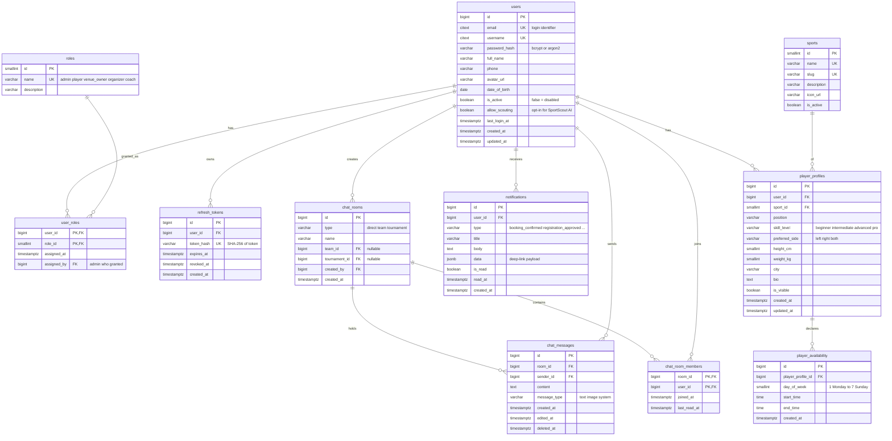
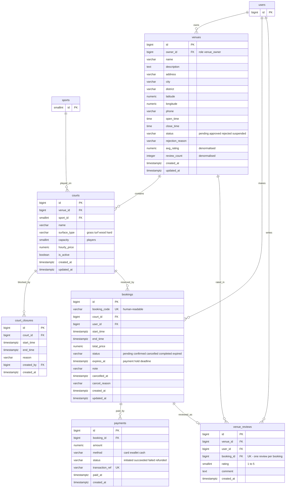
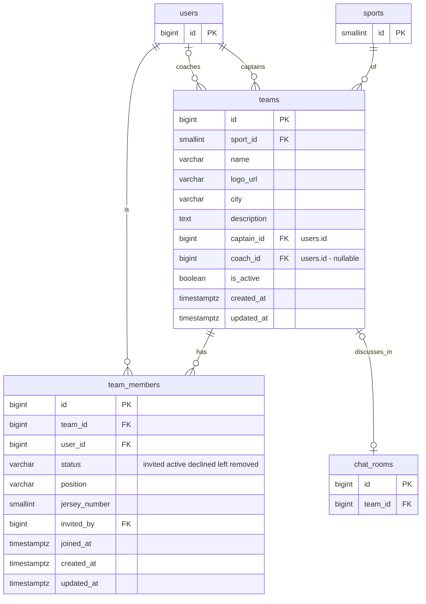
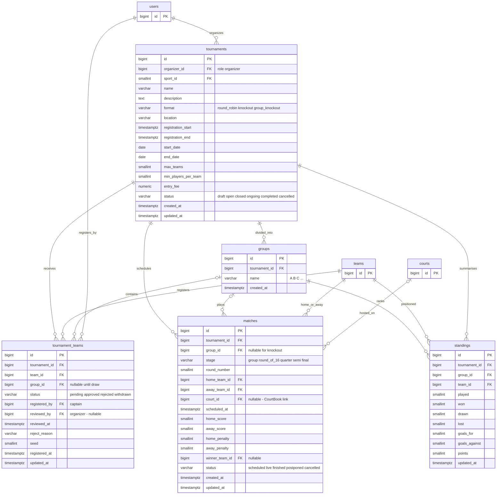
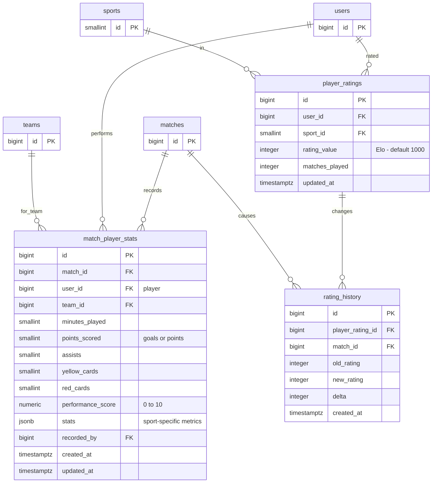
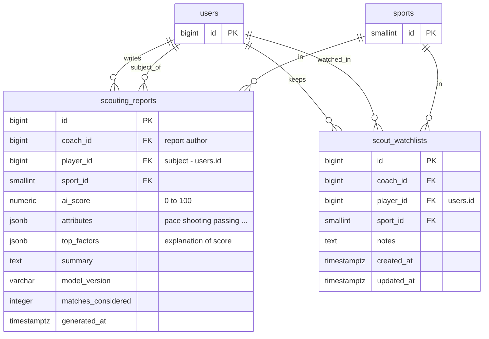
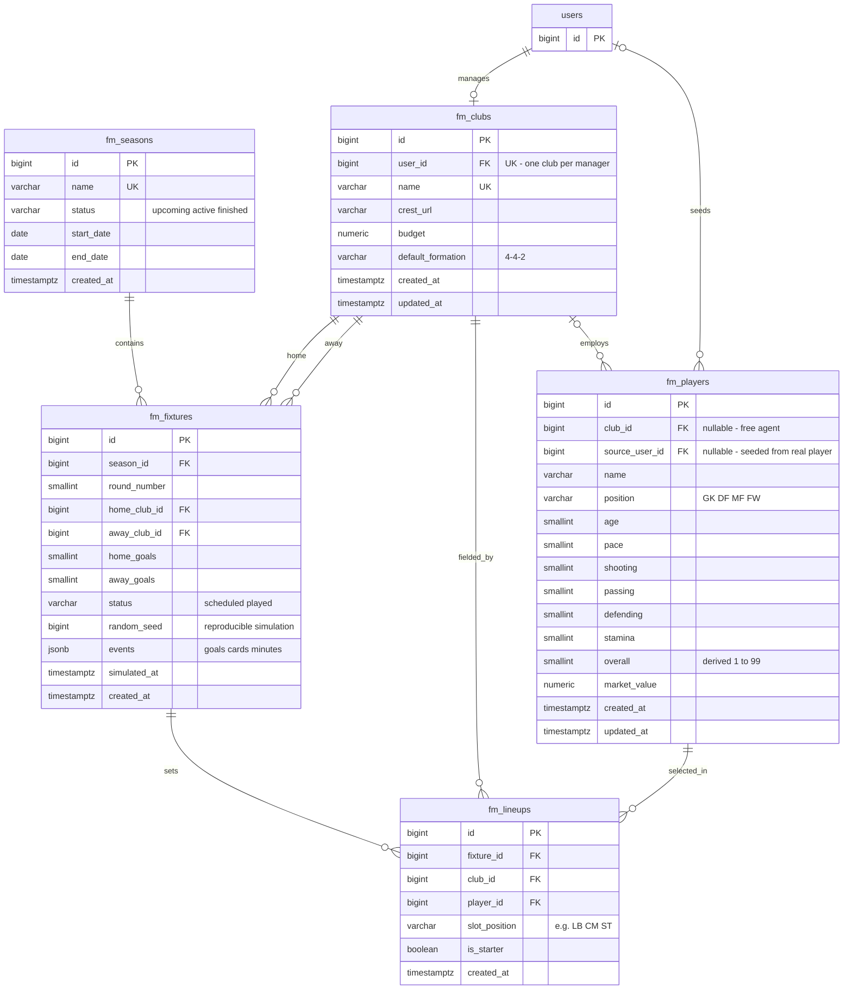
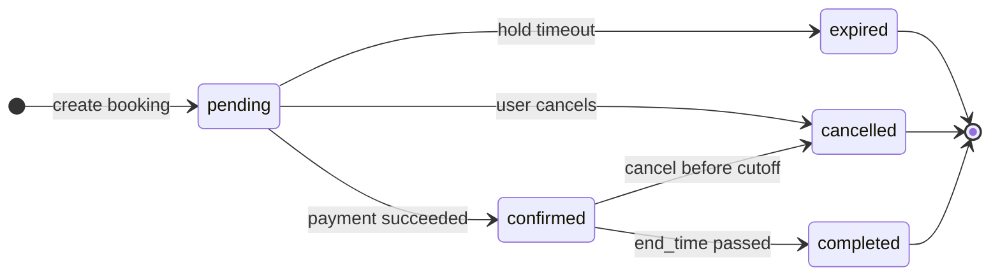
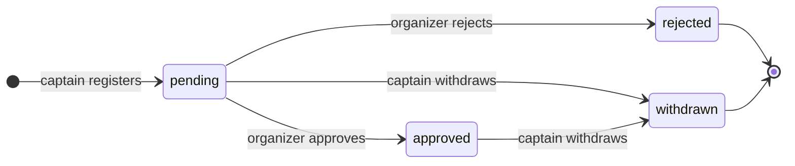

# Entity-Relationship Design (ERD)

**Project:** Sports Ecosystem & AI Platform
**Document ID:** `02-ERD` | **Version:** 1.0 | **Status:** Draft for review
**DBMS:** PostgreSQL 16 | **Depends on:** `01-SRS.md`

---

## Table of Contents

1. [Design Principles and Conventions](#1-design-principles-and-conventions)
2. [Conceptual Overview (all entities)](#2-conceptual-overview-all-entities)
3. [Core Schema](#3-core-schema)
4. [CourtBook Schema](#4-courtbook-schema)
5. [SportHub / Teams Schema](#5-sporthub--teams-schema)
6. [SportArena Schema](#6-sportarena-schema)
7. [SportIQ Schema](#7-sportiq-schema)
8. [SportScout AI Schema](#8-sportscout-ai-schema)
9. [Football Manager Lite Schema](#9-football-manager-lite-schema)
10. [Integrity Constraints and Business Rules](#10-integrity-constraints-and-business-rules)
11. [Index Strategy](#11-index-strategy)
12. [Enumerations](#12-enumerations)
13. [Table Catalogue and Requirement Traceability](#13-table-catalogue-and-requirement-traceability)

---

## 1. Design Principles and Conventions

| Topic | Decision |
|-------|----------|
| **Table names** | Plural `snake_case` (`users`, `player_profiles`). Football Manager Lite tables use the prefix `fm_` (`fm_clubs`). |
| **Primary keys** | `id bigint GENERATED ALWAYS AS IDENTITY`. Junction tables with a natural composite key use that composite as PK. |
| **Foreign keys** | `<singular_table>_id`; always declared with an explicit `ON DELETE` rule (`CASCADE`, `RESTRICT` or `SET NULL`). |
| **Timestamps** | `created_at` (default `now()`) and `updated_at` as `timestamptz`, stored in UTC. |
| **Soft delete** | Only where history matters (`users.is_active`, `chat_messages.deleted_at`); otherwise hard delete or status enums. |
| **Enumerations** | `varchar` + `CHECK` constraint (easier to migrate than native `ENUM`); values listed in [§12](#12-enumerations). |
| **Money** | `numeric(12,2)` in VND-compatible units; never floating point. |
| **Text search** | `citext` for case-insensitive `email` and `username`. |
| **Flexible data** | `jsonb` only for sport-specific or model-generated payloads (`stats`, `attributes`, `data`). |
| **Normalisation** | Schema is in 3NF; the only intentional denormalisations are `venues.avg_rating`, `standings.*` and `player_ratings.matches_played` (derived, maintained transactionally) for read performance. |
| **Extensions** | `btree_gist` (booking exclusion constraint), `citext` — installed by `docker/postgres/init/01-extensions.sql`. |

**Mermaid notation:** `||` exactly one · `o|` zero or one · `}o` zero or many ·
`}|` one or many. Key markers: `PK` primary key, `FK` foreign key, `UK` unique.

---

## 2. Conceptual Overview (all entities)

Relationships only (attributes are shown in the module diagrams below).

```mermaid
erDiagram
    users ||--o{ user_roles : has
    roles ||--o{ user_roles : granted_as
    users ||--o{ refresh_tokens : owns
    users ||--o{ player_profiles : has
    sports ||--o{ player_profiles : of
    player_profiles ||--o{ player_availability : declares
    users ||--o{ notifications : receives
    users ||--o{ chat_room_members : joins
    chat_rooms ||--o{ chat_room_members : contains
    chat_rooms ||--o{ chat_messages : holds
    users ||--o{ chat_messages : sends

    users ||--o{ venues : owns
    venues ||--o{ courts : contains
    sports ||--o{ courts : played_on
    courts ||--o{ bookings : reserved_by
    users ||--o{ bookings : makes
    bookings ||--o{ payments : paid_by
    courts ||--o{ court_closures : blocked_by
    venues ||--o{ venue_reviews : rated_in
    bookings ||--o| venue_reviews : reviewed_as

    sports ||--o{ teams : of
    users ||--o{ teams : captains
    teams ||--o{ team_members : has
    users ||--o{ team_members : is
    teams |o--o| chat_rooms : discusses_in

    users ||--o{ tournaments : organizes
    sports ||--o{ tournaments : of
    tournaments ||--o{ tournament_teams : receives
    teams ||--o{ tournament_teams : registers
    tournaments ||--o{ groups : divided_into
    groups ||--o{ tournament_teams : contains
    tournaments ||--o{ matches : schedules
    groups ||--o{ matches : plays
    teams ||--o{ matches : competes
    courts |o--o{ matches : hosted_on
    groups ||--o{ standings : ranks
    teams ||--o{ standings : positioned

    matches ||--o{ match_player_stats : records
    users ||--o{ match_player_stats : performs
    users ||--o{ player_ratings : rated
    sports ||--o{ player_ratings : in
    player_ratings ||--o{ rating_history : changes
    matches ||--o{ rating_history : causes

    users ||--o{ scouting_reports : writes
    users ||--o{ scouting_reports : subject_of
    users ||--o{ scout_watchlists : keeps
    users ||--o{ scout_watchlists : watched_in

    users ||--o| fm_clubs : manages
    fm_clubs ||--o{ fm_players : employs
    users |o--o{ fm_players : seeds
    fm_seasons ||--o{ fm_fixtures : contains
    fm_clubs ||--o{ fm_fixtures : plays
    fm_fixtures ||--o{ fm_lineups : sets
    fm_players ||--o{ fm_lineups : selected_in
```



---

## 3. Core Schema

Tables: `users`, `roles`, `user_roles`, `refresh_tokens`, `sports`,
`player_profiles`, `player_availability`, `notifications`, `chat_rooms`,
`chat_room_members`, `chat_messages`.



**Notes**

- `user_roles` implements the many-to-many between `users` and `roles` so one
  person can be both `player` and `coach`. The `roles` table is seeded with the
  five roles of the SRS and is read-mostly.
- `player_profiles` has `UNIQUE (user_id, sport_id)`: one profile per user and sport.
- `player_availability` has `CHECK (end_time > start_time)` and `CHECK (day_of_week BETWEEN 1 AND 7)`.
- `chat_rooms` has `CHECK` that `team` rooms carry `team_id`, `tournament` rooms carry `tournament_id`, `direct` rooms carry neither. `team_id` and `tournament_id` are `UNIQUE` (at most one room each).
- `chat_rooms.team_id` / `tournament_id` foreign keys point to `teams` and `tournaments` (shown in §5–6; omitted here to keep the diagram readable).

---

## 4. CourtBook Schema

Tables: `venues`, `courts`, `court_closures`, `bookings`, `payments`, `venue_reviews`.



**Notes**

- `bookings.start_time`/`end_time` are half-open: the interval is `[start_time, end_time)`, so back-to-back bookings (10:00–11:00 and 11:00–12:00) are allowed.
- **Double-booking prevention** is enforced by an exclusion constraint (see [§10.1](#101-no-overlapping-bookings-double-booking-prevention)).
- `court_closures` have their own exclusion constraint so closures cannot overlap each other; overlap between a closure and bookings is checked in the service layer inside the booking transaction.
- `venues`: `CHECK (close_time > open_time)`; `courts`: `CHECK (hourly_price >= 0)`.
- `venue_reviews`: `UNIQUE (booking_id)`, `CHECK (rating BETWEEN 1 AND 5)`.

---

## 5. SportHub / Teams Schema

Tables: `teams`, `team_members` (player profile and chat tables are in §3).



**Notes**

- `teams`: `UNIQUE (sport_id, name)`.
- `team_members`: `UNIQUE (team_id, user_id)`; partial unique index `(team_id, jersey_number) WHERE status = 'active'`.
- The captain is also inserted as an `active` member; service logic keeps `teams.captain_id` and membership consistent (captain cannot leave without transferring).

---

## 6. SportArena Schema

Tables: `tournaments`, `tournament_teams`, `groups`, `matches`, `standings`.



**Notes**

- `tournament_teams`: `UNIQUE (tournament_id, team_id)`. The *registration approval workflow* is the `status` column: `pending → approved | rejected`, and `withdrawn` from `pending`/`approved`.
- `groups`: `UNIQUE (tournament_id, name)`.
- `standings`: `UNIQUE (group_id, team_id)`; ranking = `points DESC, goal_difference DESC, goals_for DESC`.
- `matches`: `CHECK (home_team_id <> away_team_id)`; scores are `NULL` until `finished`.
- `tournaments`: `CHECK (registration_end > registration_start)`, `CHECK (start_date >= registration_end::date)`, `CHECK (max_teams >= 2)`.
- Capacity rule (`approved` count ≤ `max_teams`) is enforced in the approval transaction under a row lock on the tournament (see [§10.3](#103-tournament-capacity)).

---

## 7. SportIQ Schema

Tables: `match_player_stats`, `player_ratings`, `rating_history`.



**Notes**

- `match_player_stats`: `UNIQUE (match_id, user_id)`; `CHECK (minutes_played >= 0)`.
- `player_ratings`: `UNIQUE (user_id, sport_id)`.
- `rating_history`: `UNIQUE (player_rating_id, match_id)` makes the Elo update **idempotent** (re-processing a match cannot double-apply).
- `rating_history.delta = new_rating - old_rating` (`CHECK`).

---

## 8. SportScout AI Schema

Tables: `scouting_reports`, `scout_watchlists`.



**Notes**

- `scout_watchlists`: `UNIQUE (coach_id, player_id, sport_id)`.
- `scouting_reports`: `CHECK (ai_score BETWEEN 0 AND 100)`, `CHECK (coach_id <> player_id)`. Reports are **immutable** snapshots (re-scoring creates a new row) so that history and model version are auditable.
- A report may only be created if the subject has `users.allow_scouting = true` and enough `match_player_stats`.

---

## 9. Football Manager Lite Schema

Tables: `fm_clubs`, `fm_players`, `fm_seasons`, `fm_fixtures`, `fm_lineups`.



**Notes**

- `fm_players`: `CHECK` that each attribute and `overall` is between 1 and 99.
- `fm_fixtures`: `CHECK (home_club_id <> away_club_id)`, `UNIQUE (season_id, round_number, home_club_id)`.
- `fm_lineups`: `UNIQUE (fixture_id, player_id)`; exactly 11 starters per club and fixture is validated in the service layer (a deferred constraint trigger may be added later).
- The league table is **derived** from `fm_fixtures` (view/query) — no stored table is needed.
- `fm_players.source_user_id` links to a real player only when that player has `allow_scouting = true` (consent reuse).

---

## 10. Integrity Constraints and Business Rules

### 10.1 No overlapping bookings (double-booking prevention)

The guarantee is delegated to PostgreSQL so that it holds under **any**
concurrency level and regardless of which code path writes the row.

```sql
-- Requires: CREATE EXTENSION btree_gist;
ALTER TABLE bookings
  ADD CONSTRAINT ex_bookings_no_overlap
  EXCLUDE USING gist (
      court_id WITH =,
      tstzrange(start_time, end_time, '[)') WITH &&
  )
  WHERE (status IN ('pending', 'confirmed'));

ALTER TABLE bookings
  ADD CONSTRAINT ck_bookings_time_order CHECK (end_time > start_time);
```

How it works:

- Two rows conflict when they have the **same `court_id`** *and* their time ranges **overlap** (`&&`).
- The `WHERE` clause makes only `pending` and `confirmed` rows "active"; `cancelled`, `expired` and `completed` rows never block a slot, so cancelling or expiring a booking frees it automatically.
- `'[)'` (closed start, open end) allows adjacent bookings.
- A conflicting `INSERT`/`UPDATE` raises SQLSTATE `23P01` (`exclusion_violation`), which the API maps to **HTTP 409** `{ "detail": "Time slot is already booked" }`.
- Of two simultaneous transactions inserting overlapping rows, one commits and the other fails — no check-then-insert race window exists.

### 10.2 Other key constraints

| Table | Constraint | Purpose |
|-------|-----------|---------|
| `users` | `UNIQUE (email)`, `UNIQUE (username)` (citext) | Case-insensitive identity |
| `user_roles` | `PRIMARY KEY (user_id, role_id)` | No duplicate role grants |
| `player_profiles` | `UNIQUE (user_id, sport_id)` | One profile per sport |
| `bookings` | `ex_bookings_no_overlap`, `ck_bookings_time_order`, `UNIQUE (booking_code)` | Integrity of reservations |
| `court_closures` | `EXCLUDE USING gist (court_id WITH =, tstzrange(start_time,end_time,'[)') WITH &&)` | Closures cannot overlap |
| `venue_reviews` | `UNIQUE (booking_id)`, `CHECK (rating BETWEEN 1 AND 5)` | One review per booking |
| `teams` | `UNIQUE (sport_id, name)` | No duplicate team names per sport |
| `team_members` | `UNIQUE (team_id, user_id)` | Single membership row per player and team |
| `tournament_teams` | `UNIQUE (tournament_id, team_id)` | A team registers once per tournament |
| `groups` | `UNIQUE (tournament_id, name)` | Unique group labels |
| `matches` | `CHECK (home_team_id <> away_team_id)` | A team cannot play itself |
| `match_player_stats` | `UNIQUE (match_id, user_id)` | One stat line per player and match |
| `rating_history` | `UNIQUE (player_rating_id, match_id)` | Idempotent Elo updates |
| `scout_watchlists` | `UNIQUE (coach_id, player_id, sport_id)` | No duplicate watch entries |
| `fm_clubs` | `UNIQUE (user_id)` | One club per user |

### 10.3 Tournament capacity

`approved` registrations ≤ `tournaments.max_teams` is checked while holding a
row lock on the tournament:

```sql
BEGIN;
SELECT max_teams FROM tournaments WHERE id = :tid FOR UPDATE;   -- serialises approvals
SELECT count(*) FROM tournament_teams
 WHERE tournament_id = :tid AND status = 'approved';            -- compare with max_teams
UPDATE tournament_teams SET status = 'approved', reviewed_by = :uid, reviewed_at = now()
 WHERE id = :rid AND status = 'pending';
COMMIT;
```

### 10.4 Referential actions

| Relationship | `ON DELETE` | Rationale |
|--------------|-------------|-----------|
| `user_roles.user_id`, `refresh_tokens.user_id`, `notifications.user_id` | `CASCADE` | Dependent data has no meaning without the user |
| `player_availability.player_profile_id` | `CASCADE` | Owned by the profile |
| `courts.venue_id` | `RESTRICT` | Venue with courts cannot be deleted — deactivate instead |
| `bookings.court_id`, `bookings.user_id` | `RESTRICT` | Preserve financial and historical records |
| `payments.booking_id` | `RESTRICT` | Audit trail |
| `team_members.team_id` | `CASCADE` | Membership belongs to the team |
| `tournament_teams.team_id`, `matches.*_team_id` | `RESTRICT` | Keep tournament history intact |
| `matches.court_id`, `tournament_teams.group_id` | `SET NULL` | Optional links |
| `chat_messages.room_id` | `CASCADE` | Messages belong to the room |
| `fm_players.club_id` | `SET NULL` | Player becomes a free agent |

---

## 11. Index Strategy

| Table | Index | Supports |
|-------|-------|----------|
| `users` | `uq_users_email`, `uq_users_username` (unique, citext) | Login, uniqueness |
| `refresh_tokens` | `ix_refresh_tokens_user_id`, `uq_refresh_tokens_token_hash` | Rotation and revocation |
| `venues` | `ix_venues_city_status (city, status)` | FR-CB-04 search |
| `courts` | `ix_courts_venue_id`, `ix_courts_sport_id` | Venue pages, sport filter |
| `bookings` | GiST index created by `ex_bookings_no_overlap`; `ix_bookings_user_id_start_time`; `ix_bookings_court_id_start_time`; partial `ix_bookings_pending_expires_at (expires_at) WHERE status = 'pending'` | Overlap check, "my bookings", calendar, expiry job |
| `player_profiles` | `ix_player_profiles_sport_city_level (sport_id, city, skill_level)` | FR-SH-03 search |
| `player_availability` | `ix_player_availability_profile_day (player_profile_id, day_of_week)` | Availability overlap |
| `notifications` | `ix_notifications_user_unread (user_id, is_read, created_at DESC)` | Notification centre |
| `chat_messages` | `ix_chat_messages_room_created (room_id, created_at DESC)` | Paginated history |
| `tournament_teams` | `ix_tournament_teams_tournament_status (tournament_id, status)` | Pending list, capacity count |
| `matches` | `ix_matches_tournament_scheduled (tournament_id, scheduled_at)` | Fixture lists |
| `standings` | `uq_standings_group_team` | Table updates |
| `match_player_stats` | `ix_match_player_stats_user_id` | Personal dashboard |
| `player_ratings` | `ix_player_ratings_sport_rating (sport_id, rating_value DESC)` | Leaderboards |
| `scouting_reports` | `ix_scouting_reports_player_generated (player_id, generated_at DESC)` | Latest report |
| `fm_fixtures` | `ix_fm_fixtures_season_round (season_id, round_number)` | Season views |

---

## 12. Enumerations

| Column | Allowed values |
|--------|----------------|
| `roles.name` | `admin`, `player`, `venue_owner`, `organizer`, `coach` |
| `player_profiles.skill_level` | `beginner`, `intermediate`, `advanced`, `pro` |
| `chat_rooms.type` | `direct`, `team`, `tournament` |
| `chat_messages.message_type` | `text`, `image`, `system` |
| `venues.status` | `pending`, `approved`, `rejected`, `suspended` |
| `bookings.status` | `pending`, `confirmed`, `cancelled`, `completed`, `expired` |
| `payments.status` | `initiated`, `succeeded`, `failed`, `refunded` |
| `team_members.status` | `invited`, `active`, `declined`, `left`, `removed` |
| `tournaments.format` | `round_robin`, `knockout`, `group_knockout` |
| `tournaments.status` | `draft`, `open`, `closed`, `ongoing`, `completed`, `cancelled` |
| `tournament_teams.status` | `pending`, `approved`, `rejected`, `withdrawn` |
| `matches.status` | `scheduled`, `live`, `finished`, `postponed`, `cancelled` |
| `fm_seasons.status` | `upcoming`, `active`, `finished` |
| `fm_fixtures.status` | `scheduled`, `played` |

### State machines





---

## 13. Table Catalogue and Requirement Traceability

| # | Table | Module | Main purpose | Key requirements |
|---|-------|--------|--------------|------------------|
| 1 | `users` | Core | Accounts and credentials | FR-CORE-01…07 |
| 2 | `roles` | Core | Role catalogue | FR-CORE-05, 07 |
| 3 | `user_roles` | Core | User ↔ role assignment (M:N) | FR-CORE-05, 07 |
| 4 | `refresh_tokens` | Core | Revocable refresh tokens | FR-CORE-04, NFR-SEC-03 |
| 5 | `sports` | Core | Sports catalogue | FR-CORE-08 |
| 6 | `player_profiles` | Core / SportHub | Per-sport player profile | FR-SH-01 |
| 7 | `player_availability` | Core / SportHub | Weekly availability | FR-SH-02, 03 |
| 8 | `notifications` | Core | In-app notifications | FR-CORE-09, 12 |
| 9 | `chat_rooms` | Core / SportHub | Direct, team, tournament rooms | FR-SH-07 |
| 10 | `chat_room_members` | Core / SportHub | Room membership | FR-SH-07, 08 |
| 11 | `chat_messages` | Core / SportHub | Messages | FR-SH-08, 10 |
| 12 | `venues` | CourtBook | Facilities | FR-CB-01, 03, 04 |
| 13 | `courts` | CourtBook | Bookable courts | FR-CB-02, 08 |
| 14 | `court_closures` | CourtBook | Maintenance / blocked time | FR-CB-11 |
| 15 | `bookings` | CourtBook | Reservations (exclusion constraint) | FR-CB-06…10 |
| 16 | `payments` | CourtBook | Payment records | FR-CB-09, 14 |
| 17 | `venue_reviews` | CourtBook | Ratings and comments | FR-CB-13 |
| 18 | `teams` | SportHub | Teams | FR-SH-04, 06 |
| 19 | `team_members` | SportHub | Team membership and invitations | FR-SH-05, 06 |
| 20 | `tournaments` | SportArena | Tournaments | FR-SA-01…03 |
| 21 | `tournament_teams` | SportArena | Registrations and approval | FR-SA-04…08 |
| 22 | `groups` | SportArena | Tournament groups | FR-SA-09 |
| 23 | `matches` | SportArena | Fixtures and results | FR-SA-10, 11 |
| 24 | `standings` | SportArena | Group tables | FR-SA-11, 12 |
| 25 | `match_player_stats` | SportIQ | Per-player match stats | FR-SIQ-01, 02 |
| 26 | `player_ratings` | SportIQ | Current Elo per sport | FR-SIQ-03, 06 |
| 27 | `rating_history` | SportIQ | Elo audit trail | FR-SIQ-04 |
| 28 | `scouting_reports` | SportScout AI | AI report snapshots | FR-SC-01, 02, 06 |
| 29 | `scout_watchlists` | SportScout AI | Coach watchlist | FR-SC-04 |
| 30 | `fm_clubs` | Football Manager Lite | Virtual clubs | FR-FM-01 |
| 31 | `fm_players` | Football Manager Lite | Virtual players | FR-FM-02, 03 |
| 32 | `fm_seasons` | Football Manager Lite | Seasons | FR-FM-06 |
| 33 | `fm_fixtures` | Football Manager Lite | Fixtures and simulation results | FR-FM-05…07 |
| 34 | `fm_lineups` | Football Manager Lite | Lineup per fixture | FR-FM-04 |

**Total: 34 tables** (11 core, 6 CourtBook, 2 teams, 5 SportArena, 3 SportIQ, 2 SportScout AI, 5 Football Manager Lite).

> Schema is implemented in Step 2 by versioned migrations; this document is
> the single source of truth until then. Any later schema change must update
> this file in the same pull request.
