# System Architecture and Interaction Flows

**Project:** Sports Ecosystem & AI Platform
**Document ID:** `03-ARCHITECTURE-AND-FLOWS` | **Version:** 1.0 | **Status:** Draft for review
**Depends on:** `01-SRS.md`, `02-ERD.md`

---

## Table of Contents

1. [Architectural Overview and Style](#1-architectural-overview-and-style)
2. [Proposed Technology Stack](#2-proposed-technology-stack)
3. [High-Level System Architecture](#3-high-level-system-architecture)
4. [Backend Internal Structure](#4-backend-internal-structure)
5. [Deployment View](#5-deployment-view)
6. [API Conventions](#6-api-conventions)
7. [Security Architecture and RBAC Matrix](#7-security-architecture-and-rbac-matrix)
8. [Flow 1 — Registration, Login (JWT) and RBAC](#8-flow-1--registration-login-jwt-and-rbac)
9. [Flow 2 — Court Booking with Double-Booking Prevention](#9-flow-2--court-booking-with-double-booking-prevention)
10. [Flow 3 — Tournament Registration and Organizer Approval](#10-flow-3--tournament-registration-and-organizer-approval)
11. [Cross-Cutting Concerns](#11-cross-cutting-concerns)
12. [Architecture Decision Records](#12-architecture-decision-records)

---

## 1. Architectural Overview and Style

The platform is a **modular monolith** exposed through a **stateless REST API**
(plus one WebSocket endpoint for chat and live notifications) and consumed by a
**single-page application**.

| Driver (from SRS) | Architectural response |
|-------------------|------------------------|
| Six functional modules sharing users, roles and player data | One deployable backend, one database, **module packages with explicit boundaries** — cross-module calls go through service interfaces only |
| Small student team, one semester (CON-05) | Monolith avoids distributed-systems overhead; modules can still be split later |
| Booking integrity under concurrency (NFR-REL-02) | Integrity enforced **inside PostgreSQL** (exclusion constraint, row locks) |
| Horizontal scalability (NFR-SCA-01) | Stateless API + JWT; state only in PostgreSQL |
| Real-time chat/notifications (NFR-PERF-03) | WebSocket endpoint authenticated by the same JWT |
| Advisory AI (ASM-05) | AI engine is an **in-process component** of SportScout AI (model loaded from file), isolated behind an interface so it can become a separate service |
| Documentation-first (CON-04) | This document, the SRS and the ERD precede code |

---

## 2. Proposed Technology Stack

> The conventions (`/api/v1`, `{ "detail": ... }`) match FastAPI's defaults.
> Final selection is confirmed at the start of Step 2.

| Layer | Technology | Notes |
|-------|-----------|-------|
| Frontend | React + TypeScript (Vite), React Router, TanStack Query, Tailwind CSS | SPA, responsive, i18n (vi/en) |
| Backend | Python 3.12, **FastAPI**, Pydantic v2, SQLAlchemy 2.0, Alembic | Auto-generated OpenAPI (NFR-DOC-01) |
| Auth | JWT (`PyJWT`), password hashing with `bcrypt`/`argon2-cffi` | Access + rotating refresh tokens |
| Database | **PostgreSQL 16** (`btree_gist`, `citext`) | Single primary datastore |
| Real-time | FastAPI WebSocket | Chat and notification push |
| Background jobs | APScheduler (in-process) | Booking expiry, reminders, rating recalculation |
| AI | scikit-learn / pandas, model persisted with `joblib` | Gradient boosting or weighted baseline (OI-05) |
| Tooling | Docker Compose, pytest, Ruff, ESLint, GitHub Actions | CI: lint → test → build |

---

## 3. High-Level System Architecture

### 3.1 Context and containers

```mermaid
flowchart TB
    subgraph USERS["Users"]
        PL(["Player"])
        VO(["Venue Owner"])
        OR(["Organizer"])
        CO(["Coach"])
        AD(["Admin"])
    end

    subgraph CLIENT["Client tier"]
        SPA["Web SPA<br/>React + TypeScript"]
    end

    subgraph SERVER["Application tier - FastAPI backend (modular monolith)"]
        direction TB
        GW["HTTP layer<br/>CORS, rate limiting, JWT verification, error handler"]
        WS["WebSocket gateway<br/>chat and live notifications"]
        subgraph MODS["Business modules"]
            direction LR
            M0["Core<br/>auth, users, roles, sports,<br/>profiles, notifications, chat"]
            M1["CourtBook"]
            M2["SportHub"]
            M3["SportArena"]
            M4["SportIQ"]
            M5["SportScout AI"]
            M6["Football Manager Lite"]
        end
        AI["AI Engine<br/>scoring and similarity model"]
        SCH["Scheduler<br/>expiry, reminders, rating jobs"]
    end

    subgraph DATA["Data tier"]
        PG[("PostgreSQL 16<br/>persistent volume")]
        FS[("File storage<br/>avatars, logos, model files")]
    end

    subgraph EXT["External services"]
        PAY["Payment gateway<br/>sandbox"]
        MAIL["SMTP / mailer"]
    end

    USERS --> SPA
    SPA -- "HTTPS /api/v1  JSON + Bearer JWT" --> GW
    SPA -- "WSS  JWT" --> WS
    GW --> MODS
    WS --> M0
    M0 --- PG
    M1 --- PG
    M2 --- PG
    M3 --- PG
    M4 --- PG
    M5 --- PG
    M6 --- PG
    M5 --> AI
    AI --> M4
    M3 -- "match finished" --> M4
    M1 -- "court for fixture" --> M3
    M4 -- "seed attributes" --> M6
    M2 -- "teams" --> M3
    SCH --> M1
    SCH --> M4
    M1 -- "payment request / callback" --> PAY
    M0 --> MAIL
    M0 --- FS
```

### 3.2 Module responsibilities and dependencies

| Module | Owns tables | Depends on (service calls) | Exposes |
|--------|-------------|----------------------------|---------|
| **Core** | `users`, `roles`, `user_roles`, `refresh_tokens`, `sports`, `player_profiles`, `player_availability`, `notifications`, `chat_*` | — | Auth dependencies (`get_current_user`, `require_roles`), `NotificationService`, `ChatService` |
| **CourtBook** | `venues`, `courts`, `court_closures`, `bookings`, `payments`, `venue_reviews` | Core | `/venues`, `/courts`, `/bookings` |
| **SportHub** | `teams`, `team_members` | Core | `/teams`, `/players`, `/chat` |
| **SportArena** | `tournaments`, `tournament_teams`, `groups`, `matches`, `standings` | Core, SportHub, CourtBook (optional) | `/tournaments`, `/matches` |
| **SportIQ** | `match_player_stats`, `player_ratings`, `rating_history` | Core, SportArena | `/stats`, `/ratings`, `/leaderboards` |
| **SportScout AI** | `scouting_reports`, `scout_watchlists` | Core, SportIQ, AI Engine | `/scouting` |
| **Football Manager Lite** | `fm_*` | Core, SportIQ (optional seeding) | `/fm` |

**Dependency rule:** arrows only point *downward* in this order —
`Core ← SportHub ← CourtBook ← SportArena ← SportIQ ← SportScout AI / Football Manager Lite`.
No module imports another module's repositories or ORM models; only its **service interface**.
This prevents cyclic dependencies and keeps a future split into services feasible.

---

## 4. Backend Internal Structure

### 4.1 Layers inside every module

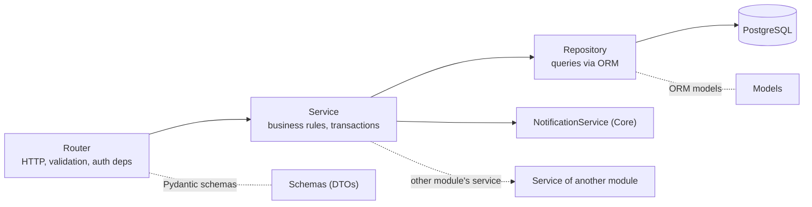

| Layer | Responsibility | Must not |
|-------|----------------|----------|
| Router | Parse/validate input, call one service method, map exceptions to `{ "detail": ... }` | Contain business logic or SQL |
| Service | Business rules, authorization at object level, transaction boundaries | Know about HTTP types |
| Repository | Persist and query entities | Decide business rules |
| Schemas / Models | DTOs and ORM entities | Cross module boundaries |

### 4.2 Planned directory layout (created in Step 2)

```text
backend/
├── app/
│   ├── main.py                 # app factory, router mounting under /api/v1
│   ├── core/                   # config, security (JWT), db session, exceptions, deps
│   ├── modules/
│   │   ├── core_platform/      # auth, users, roles, sports, profiles, notifications, chat
│   │   ├── courtbook/
│   │   ├── sporthub/
│   │   ├── sportarena/
│   │   ├── sportiq/
│   │   ├── sportscout/
│   │   └── football_manager/
│   └── ai/                     # model loading, features, scoring
├── migrations/                 # Alembic versions
├── tests/
└── pyproject.toml
frontend/
└── src/ { app, features/<module>, shared/{api,components,hooks}, i18n }
```

---

## 5. Deployment View

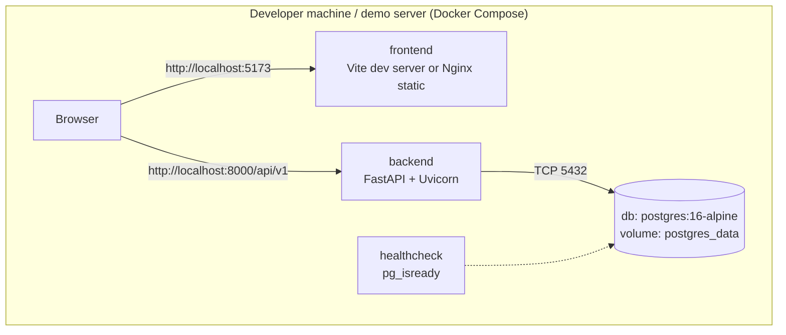

- **Step 1 (this commit):** only the `db` service exists in `docker-compose.yml`
  (persistent volume `postgres_data`, `pg_isready` healthcheck, init script
  enabling `btree_gist` and `citext`).
- **Later steps:** `backend` and `frontend` services are added;
  `backend` will use `depends_on: db: condition: service_healthy`.
- Configuration is injected through environment variables (NFR-POR-02).

---

## 6. API Conventions

| Aspect | Rule |
|--------|------|
| Base path | `/api/v1` — all routers are mounted under this prefix |
| Resources | Plural kebab-case: `/venues/{venue_id}/courts`, `/tournaments/{tournament_id}/registrations` |
| Methods | `GET` read · `POST` create/action · `PATCH` partial update · `DELETE` remove |
| Auth header | `Authorization: Bearer <access_token>` |
| Pagination | `?page=1&page_size=20` (max 100); response `{ "items": [...], "total": n, "page": 1, "page_size": 20 }` |
| Time | ISO-8601 UTC strings |
| Error body | **Always** `{ "detail": "..." }` — for `422` the value may be a list of messages |

### 6.1 Status-code mapping

| Situation | Status | Example `detail` |
|-----------|:------:|------------------|
| Created | 201 | — |
| Business rule violated | 400 | `"Cancellation period has passed"` |
| Not authenticated / token invalid or expired | 401 | `"Could not validate credentials"` |
| Authenticated but lacking role / ownership | 403 | `"Insufficient permissions"` |
| Resource missing | 404 | `"Court not found"` |
| Duplicate or overlap (incl. PostgreSQL `23505`, `23P01`) | 409 | `"Time slot is already booked"` |
| Schema validation failure | 422 | `"Invalid value for field 'end_time'"` |
| Unhandled error | 500 | `"Internal server error"` |

### 6.2 Endpoint catalogue (principal endpoints)

| Module | Endpoint | Method | Access |
|--------|----------|--------|--------|
| Auth | `/api/v1/auth/register` | POST | Public |
| Auth | `/api/v1/auth/login` | POST | Public |
| Auth | `/api/v1/auth/refresh` | POST | Public (refresh token) |
| Auth | `/api/v1/auth/logout` | POST | Authenticated |
| Users | `/api/v1/users/me` | GET, PATCH | Authenticated |
| Users | `/api/v1/users`, `/api/v1/users/{id}/roles` | GET, PUT | `admin` |
| Venues | `/api/v1/venues` | GET (public), POST | POST: `venue_owner` |
| Venues | `/api/v1/venues/{id}/approval` | PATCH | `admin` |
| Courts | `/api/v1/courts/{id}/availability?date=` | GET | Public |
| Bookings | `/api/v1/bookings` | POST, GET (own) | Authenticated |
| Bookings | `/api/v1/bookings/{id}/cancel` | POST | Booking owner, venue owner, `admin` |
| Teams | `/api/v1/teams`, `/api/v1/teams/{id}/members` | GET, POST | Authenticated |
| Tournaments | `/api/v1/tournaments` | GET (public), POST | POST: `organizer` |
| Tournaments | `/api/v1/tournaments/{id}/registrations` | POST, GET | POST: captain · GET: tournament organizer |
| Tournaments | `/api/v1/tournaments/{id}/registrations/{rid}` | PATCH | Tournament organizer, `admin` |
| SportIQ | `/api/v1/matches/{id}/stats` | PUT | `organizer`, team captain/coach, `admin` |
| SportIQ | `/api/v1/leaderboards` | GET | Public |
| Scouting | `/api/v1/scouting/reports`, `/api/v1/scouting/watchlist` | GET, POST | `coach`, `admin` |
| FM | `/api/v1/fm/clubs`, `/api/v1/fm/fixtures/{id}/simulate` | POST, GET | Authenticated |
| Chat | `/api/v1/chat/rooms/{id}/messages`, `/api/v1/ws` | GET, WebSocket | Room members |

---

## 7. Security Architecture and RBAC Matrix

### 7.1 Authentication design

| Item | Design |
|------|--------|
| Access token | JWT signed with HS256 (secret from environment), lifetime **15 min**; claims `sub` (user id), `roles` (list), `iat`, `exp`, `jti` |
| Refresh token | Opaque random 256-bit value; only its SHA-256 hash is stored in `refresh_tokens`; lifetime **7 days**; **rotated** on every use; reuse of a revoked token revokes the whole token family |
| Password storage | bcrypt/Argon2 with per-password salt |
| Transport | HTTPS in non-local environments; refresh token delivered in the JSON body (or `HttpOnly; Secure; SameSite=Strict` cookie in production) |
| Rate limiting | Login/register limited per IP and per account |
| Authorization | Two checks: **role check** (route dependency `require_roles(...)`) and **object check** in the service layer (ownership, membership, state) |

### 7.2 Request authorization pipeline

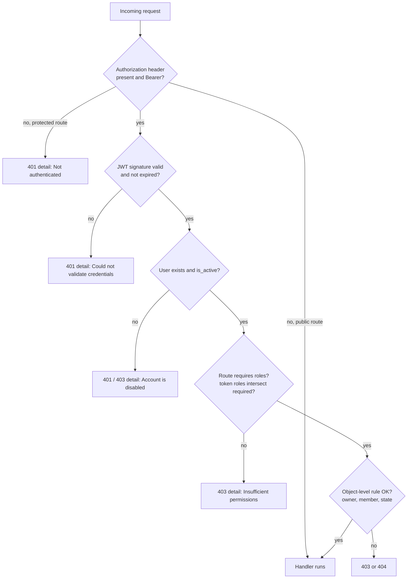

### 7.3 RBAC matrix (endpoint level)

Legend: ✔ allowed · ✔* allowed with object-level condition · ✘ denied (403) · — not applicable

| Operation | Guest | player | venue_owner | organizer | coach | admin |
|-----------|:----:|:------:|:-----------:|:---------:|:-----:|:-----:|
| Register / login | ✔ | — | — | — | — | — |
| `GET /venues`, availability, tournaments, leaderboards | ✔ | ✔ | ✔ | ✔ | ✔ | ✔ |
| `GET/PATCH /users/me` | ✘ | ✔ | ✔ | ✔ | ✔ | ✔ |
| `GET /users`, `PUT /users/{id}/roles` | ✘ | ✘ | ✘ | ✘ | ✘ | ✔ |
| Manage `sports` catalogue | ✘ | ✘ | ✘ | ✘ | ✘ | ✔ |
| `POST /venues`, courts, closures | ✘ | ✘ | ✔ | ✘ | ✘ | ✔ |
| Edit/delete venue or court | ✘ | ✘ | ✔* (own) | ✘ | ✘ | ✔ |
| `PATCH /venues/{id}/approval` | ✘ | ✘ | ✘ | ✘ | ✘ | ✔ |
| `POST /bookings` | ✘ | ✔ | ✔ | ✔ | ✔ | ✔ |
| Cancel booking | ✘ | ✔* (own) | ✔* (own court) | ✔* (own) | ✔* (own) | ✔ |
| Create/manage team | ✘ | ✔ | ✘ | ✘ | ✔ | ✔ |
| Invite/remove members | ✘ | ✔* (captain) | ✘ | ✘ | ✔* (captain) | ✔ |
| Register team to tournament | ✘ | ✔* (captain) | ✘ | ✘ | ✔* (captain) | ✔ |
| Create tournament | ✘ | ✘ | ✘ | ✔ | ✘ | ✔ |
| Approve/reject registration, groups, fixtures, results | ✘ | ✘ | ✘ | ✔* (own tournament) | ✘ | ✔ |
| Enter match statistics | ✘ | ✘ | ✘ | ✔* (own tournament) | ✔* (own team) | ✔ |
| Generate scouting report / watchlist | ✘ | ✘ | ✘ | ✘ | ✔ | ✔ |
| Football Manager Lite (own club) | ✘ | ✔ | ✔ | ✔ | ✔ | ✔ |
| Join chat room | ✘ | ✔* (member) | ✔* | ✔* | ✔* | ✔ |

### 7.4 Other security measures

- Input validation by Pydantic schemas on every endpoint; ORM parameter binding (no string-built SQL).
- CORS limited to configured origins; security headers on the static frontend.
- Generic login error message to avoid account enumeration.
- Audit log lines (structured) for login failures, role changes and booking cancellations by third parties.
- Secrets only from environment variables; `.env` excluded by `.gitignore`.

---

## 8. Flow 1 — Registration, Login (JWT) and RBAC

**Covers:** UC-AUTH-01, UC-AUTH-02, UC-AUTH-04 · FR-CORE-01…05, 07 · NFR-SEC-02/03/04

### 8.1 Registration

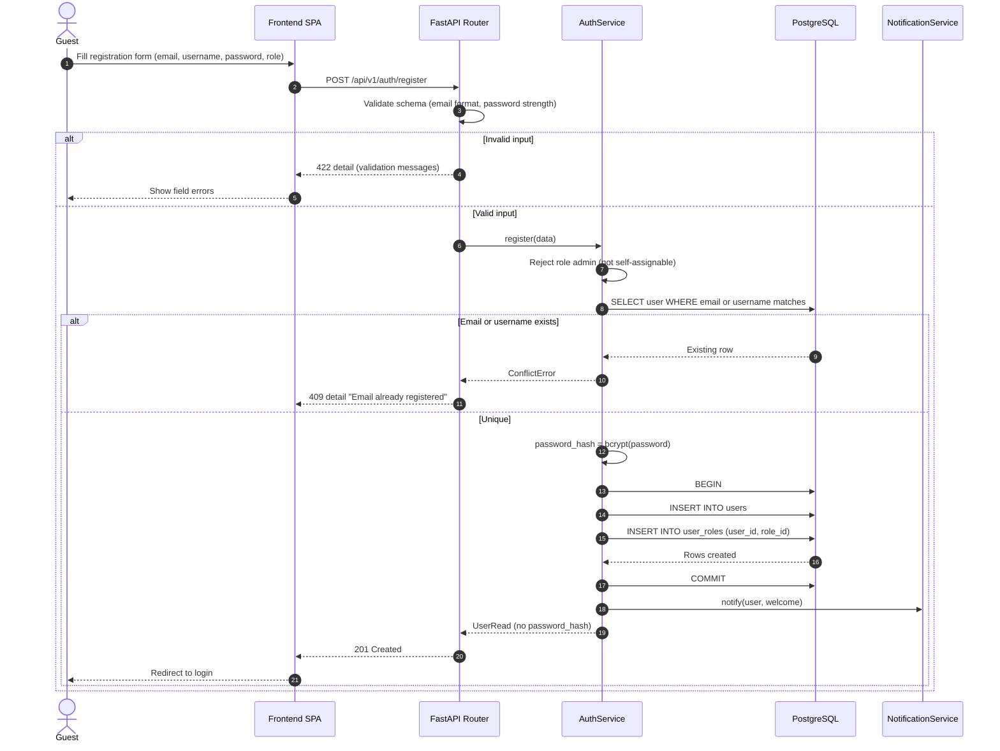

### 8.2 Login and token issuance

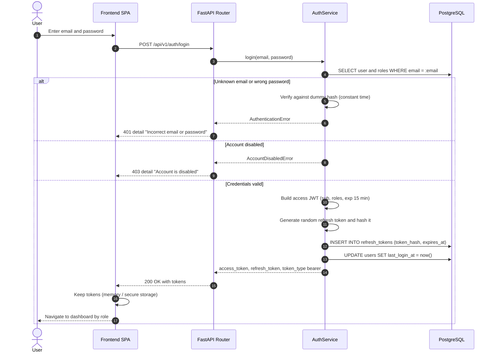

### 8.3 Authorized request (RBAC) and token refresh

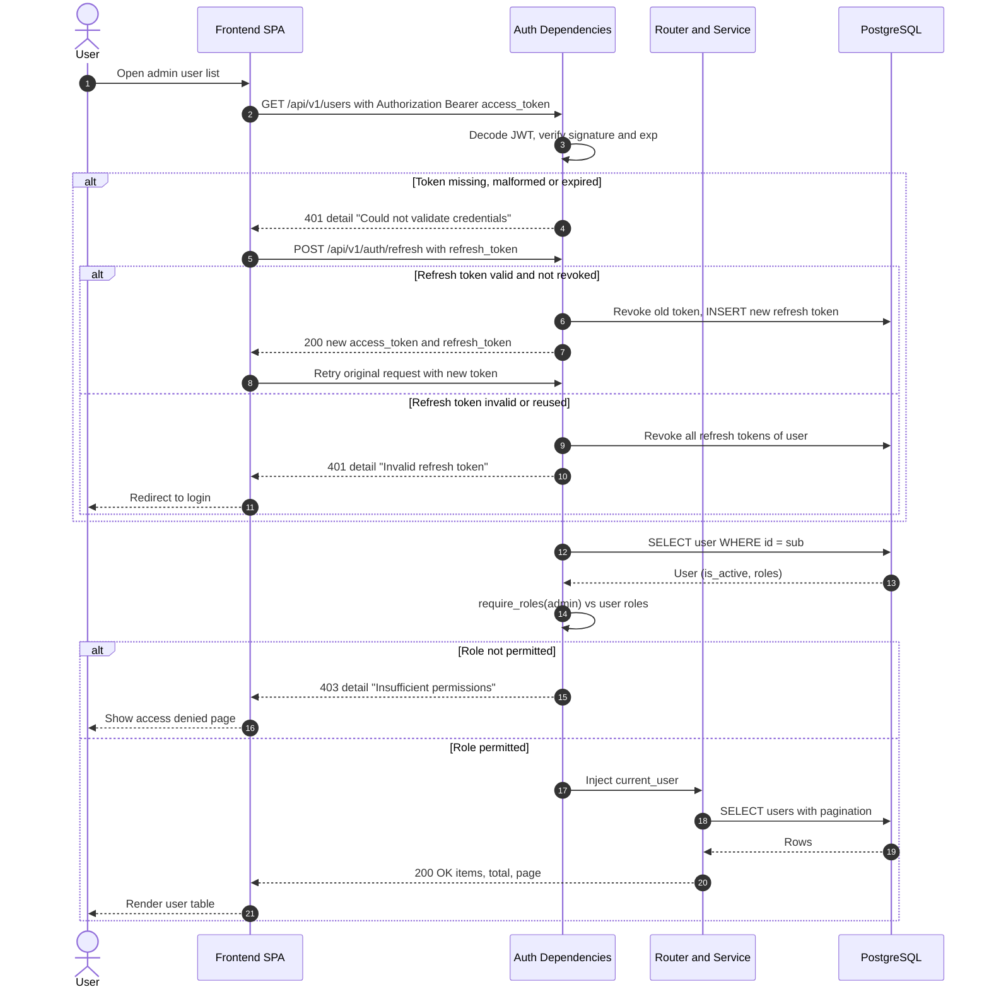

### 8.4 Role administration (RBAC change)

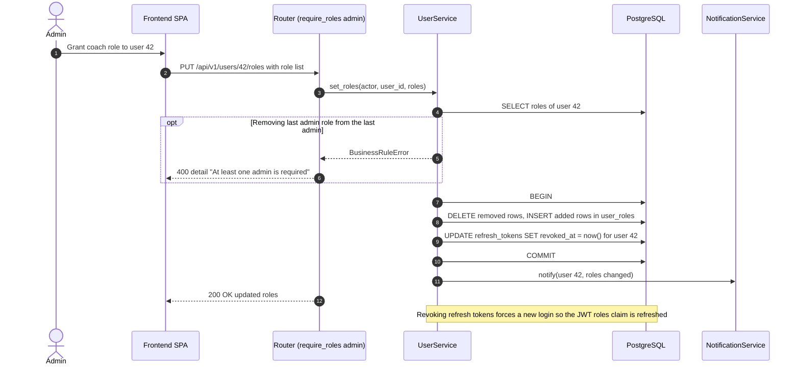

---

## 9. Flow 2 — Court Booking with Double-Booking Prevention

**Covers:** UC-CB-02, UC-CB-03, UC-CB-04 · FR-CB-05…10, 12 · NFR-REL-02/03/05

The **database exclusion constraint** `ex_bookings_no_overlap` (see ERD §10.1) is the
single source of truth. The availability query is a convenience for the UI;
only the `INSERT` guarantees the slot.

### 9.1 Create booking (including the race condition)

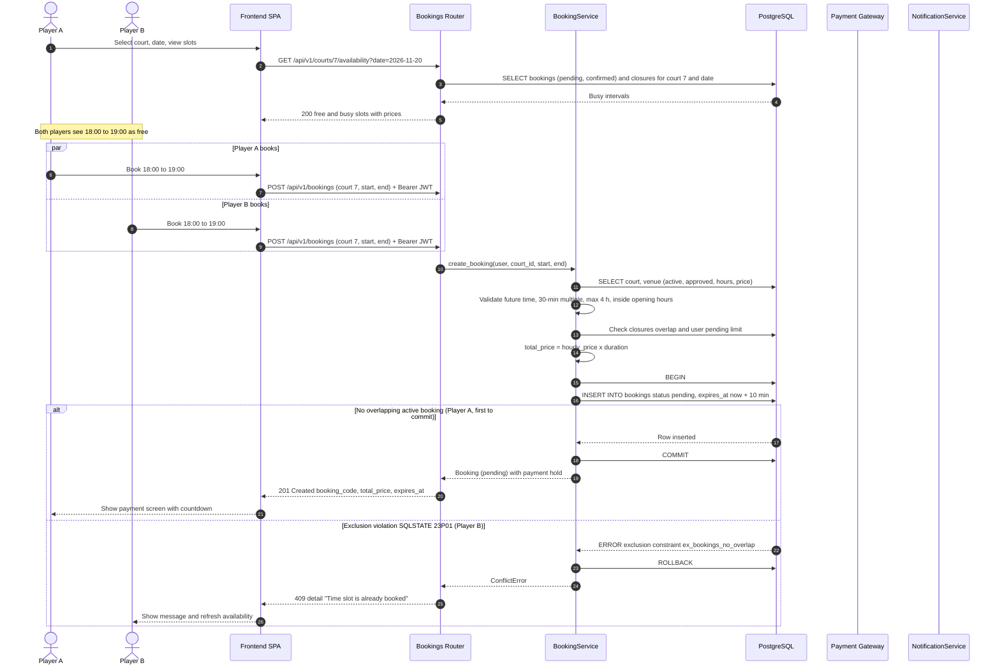

> **Why this is safe:** both `INSERT` statements run concurrently, but PostgreSQL
> serialises conflicting index entries — exactly one transaction commits; the
> other receives `23P01`. There is no "check, then insert" window in application code.

### 9.2 Payment confirmation, expiry and cancellation

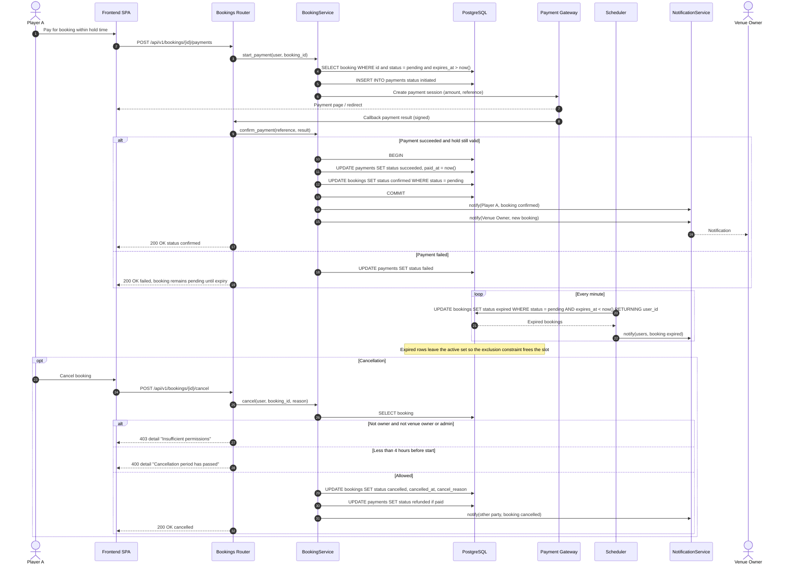

---

## 10. Flow 3 — Tournament Registration and Organizer Approval

**Covers:** UC-SA-01, UC-SA-02, UC-SA-03 · FR-SA-01…08 · NFR-REL-03

### 10.1 Registration by the team captain

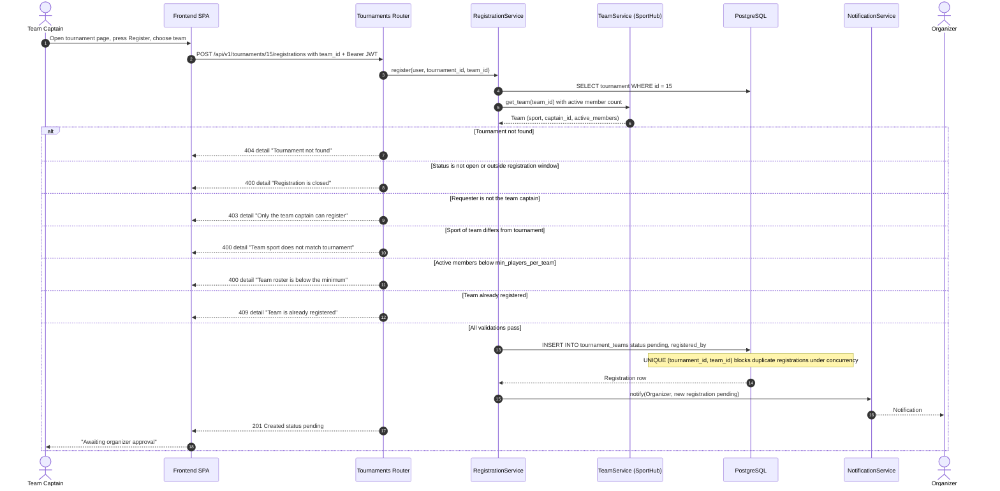

### 10.2 Organizer review (approve or reject)

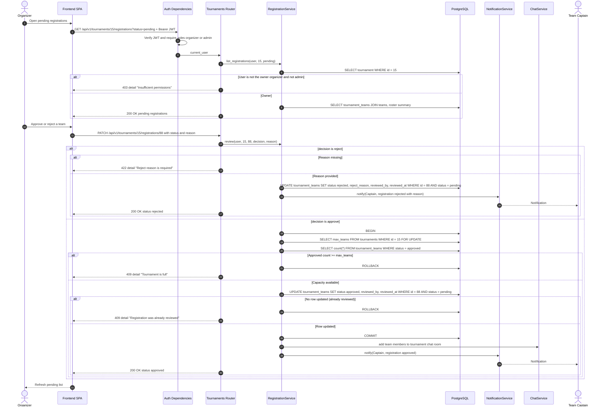

### 10.3 Withdrawal (alternative flow)

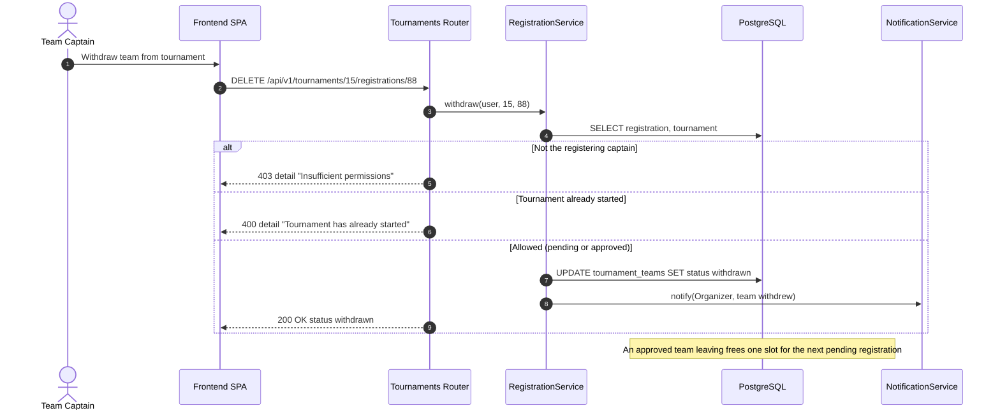

---

## 11. Cross-Cutting Concerns

| Concern | Approach |
|---------|----------|
| **Error handling** | Domain exceptions (`NotFoundError`, `ConflictError`, `BusinessRuleError`, `PermissionDenied`) are mapped by one global handler to status codes and the body `{ "detail": "..." }`; unexpected errors are logged and returned as a generic 500. |
| **Transactions** | One unit of work per request; services own commit/rollback; multi-table operations (booking + payment, approval + chat) are atomic. |
| **Concurrency** | Database-level guarantees first (exclusion constraint, unique constraints, `SELECT ... FOR UPDATE`), optimistic checks (`WHERE status = 'pending'`) second. |
| **Notifications** | Services call `NotificationService`, which persists a row and, if the recipient has an open WebSocket, pushes it. Delivery failure never fails the business transaction. |
| **Scheduling** | In-process scheduler runs: expire pending bookings (1 min), booking reminders (5 min), nightly Elo/ranking consistency check. Jobs are idempotent so multiple instances remain safe. |
| **AI integration** | `SportScout` calls `AIEngine.score(features)`; features are built from `SportIQ` services; every report records `model_version`. The engine can be swapped (rule-based baseline → trained model) without touching callers. |
| **Logging and observability** | Structured JSON logs with request id and user id; `/api/v1/health` endpoint for liveness and DB readiness. |
| **Configuration** | Environment variables parsed into a typed settings object; no secrets in code. |
| **Testing** | Unit tests for services; integration tests with a real PostgreSQL container for constraints (overlap, uniqueness, capacity); contract tests for the error format. |
| **Internationalisation** | Frontend i18n (vi/en); API `detail` messages are English and stable; the frontend maps known messages/status codes to localized text. |

---

## 12. Architecture Decision Records

| ID | Decision | Alternatives considered | Rationale |
|----|----------|------------------------|-----------|
| ADR-01 | **Modular monolith** | Microservices per module | One team, one semester, shared data model; lower operational cost; boundaries preserved for later extraction |
| ADR-02 | **PostgreSQL** as sole datastore | MongoDB, MySQL | Relational integrity, exclusion constraints and range types are essential for booking; `jsonb` covers flexible stats |
| ADR-03 | **Double-booking prevention in the database** | Application-level check, distributed lock, optimistic version column | A constraint is correct under any concurrency and any code path; application checks have a race window |
| ADR-04 | **JWT access + rotating refresh tokens** | Server-side sessions | Stateless API scales horizontally; short access lifetime and revocable refresh tokens limit exposure |
| ADR-05 | **Roles in a separate table with M:N mapping** | Single `role` column on `users` | A person can be player and coach at once (SRS §3.1); roles are data, not code |
| ADR-06 | **`varchar` + `CHECK` for enumerations** | PostgreSQL `ENUM` | Adding a value is a simple migration without type rebuilding |
| ADR-07 | **Uniform error body `{ "detail": ... }`** | Custom error codes envelope | Matches FastAPI default; one shape for the frontend to handle |
| ADR-08 | **Derived tables `standings`, `player_ratings`** kept transactionally | Compute on read | Read-heavy leaderboards and tables; updates occur inside the same transaction as the source change |
| ADR-09 | **AI engine in-process behind an interface** | Separate ML microservice | Simplicity for the capstone; interface keeps the option to externalise |
| ADR-10 | **Plural snake_case tables, `fm_` prefix only for Football Manager Lite** | Per-module schemas | Single flat namespace is simple; prefix avoids clash with real-world `players`/`matches` concepts |
